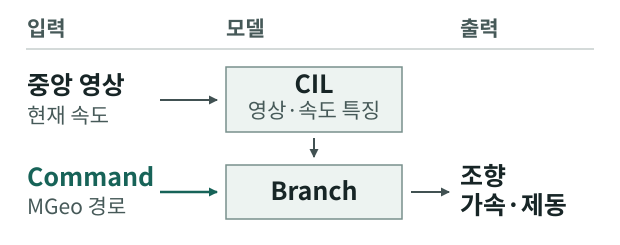
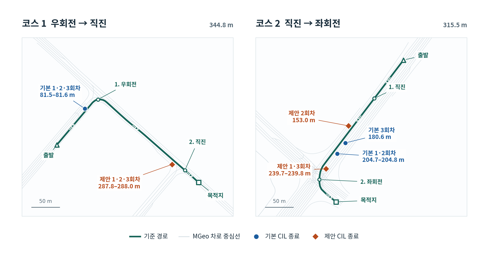

# PilotNet & CIL in MORAI

카메라 영상으로 주행을 학습하면 어디까지 갈 수 있을까? MORAI K-City에서 직접 시범 주행 데이터를 수집하고, PilotNet과 Conditional Imitation Learning(CIL)을 PyTorch로 구현했다. K-City에서 직선·곡선과 교차로 주행을 시험하고, 상암에서 여러 교차로를 잇는 경로로 시험을 넓혔다.

## 교차로 주행 데모

https://github.com/user-attachments/assets/29a55b91-5d2b-4a81-ab3a-1780c281a0f6

같은 교차로의 좌회전 경로에서 왼쪽 PilotNet은 직진 방향으로 진행했고, 오른쪽 CIL은 `LEFT` 명령에 따라 좌회전해 종점 구간에 도달했다. 두 주행은 따로 녹화했으며, 먼저 끝난 왼쪽 영상은 마지막 화면에서 멈춘다.

## PilotNet으로 조향 학습하기

PilotNet 논문은 카메라 영상에서 조향에 필요한 값을 학습하는 방법을 제안했다. MORAI에서는 Pure Pursuit로 시범 주행을 수집하고, 영상과 차량 상태의 시각을 맞춰 curvature target을 만들었다.

중앙 카메라만으로 학습한 모델과 좌·중·우 카메라로 학습한 모델을 비교했다. 두 모델 모두 주행 중에는 중앙 영상 한 장만 입력받는다. 주행 속도는 별도의 목표속도 제어기가 맞춘다.

| 학습에 쓰지 않은 시험 구간 | 중앙 카메라로 학습 | 3카메라로 학습 |
|---|---|---|
| 직선 200 m | 횡오차로 중단 | 종점 구간 도달 |
| 곡선·연결도로 약 232 m | 횡오차로 중단 | 횡오차로 중단 |

각 모델로 구간별 한 번씩 시험했다. 아래 두 비교 영상에서 왼쪽은 중앙 카메라로, 오른쪽은 3카메라로 학습한 모델이다.

직선 200 m에서는 중앙 카메라 모델은 경로를 이탈했고, 3카메라 모델은 종점 구간에 도달했다.

https://github.com/user-attachments/assets/096a658d-96da-4768-b581-1f41538266f7

곡선·연결도로에서는 두 모델 모두 경로를 이탈했다.

https://github.com/user-attachments/assets/8a0d8432-1fd0-4297-a44d-84c379cf6832

교차로에서는 진행 방향을 지정하는 문제가 남았다. 좌회전 경로를 기준으로 시험했지만 차량은 직진 방향으로 진행했고, 모델에는 좌회전 목표를 전달할 입력이 없었다. [PilotNet 전체 결과와 주행 영상](pilotnet/results/README.md)

## CIL에 진행 방향 전달하기

CIL 논문은 교차로에서 주행 정책에 원하는 방향을 알려주기 위해 high-level command를 추가했다. MORAI에서는 영상, 속도, command, control targets를 같은 시각에 맞춰 학습했다.

`MGeo` 도로 지도의 경로에서 얻은 command로 도로 추종, 교차로 직진, 좌회전, 우회전 중 어느 branch를 사용할지 정한다.

학습과 검증에 쓰지 않은 교차로에서 같은 위치를 출발점으로 두고, 기본 CIL 모델에 직진·좌회전·우회전 명령을 각각 한 번씩 줬다.

| Command | 주행 결과 | 최대 횡오차 |
|---|---|---:|
| 직진 | 종점 구간 도달 | 2.36 m |
| 좌회전 | 종점 구간 도달 | 1.32 m |
| 우회전 | 약 61 m 중 45 m 지점에서 중단 | 7.01 m |

**CIL 곡선 주행 영상**

CIL은 시범 수집 때 조향에 Noise Injection을 적용해 경로에서 벗어난 차량을 되돌리는 조향도 학습했다. 다른 도로의 시범을 추가해 재학습한 모델은 PilotNet이 이탈한 곡선·연결도로 약 232 m를 조향 보조 없이 주행해 종점 구간에 도달했다. 최대 횡오차는 0.65 m였다.

https://github.com/user-attachments/assets/6d53fb0e-0b20-41b6-929e-d573456649d6

종점 도달은 기준 경로의 마지막 1 m 구간을 기준으로 판정했다. 횡오차 7 m는 주행 관찰을 위한 중단 기준이었다. 신호 대응, 차선 준수, 충돌 여부는 이번 평가 범위에 포함하지 않았다. [CIL 전체 결과와 주행 영상](cil/results/README.md#주행-영상)

## Point-to-point 주행

### K-City 연속 주행 · 경로 95.5% 진행

여러 교차로를 이어 달리자 초기 CIL은 첫 우회전에서 멈췄다. 명령별 표본 수를 유지하면서 급우회전, 회전 중 복귀, 직진 교차로 시범을 보강했다.

https://github.com/user-attachments/assets/4e630791-cd46-4c05-bfa6-408bded24454

초기 모델은 20 km/h 상한에서 **18.9%**, 보강 모델은 15 km/h 상한과 조향 보조 1회로 **95.5%**까지 진행했다. 보강 모델도 20 km/h 상한·무보조 조건에서는 첫 우회전에서 멈췄다.

[K-City 경로와 시범 보강 기록](cil/results/README.md#k-city에서-뭐가-달라졌나)

### 상암에서 여러 교차로 주행

기존 K-City 모델을 MORAI 상암 311.8 m 경로에 배치했다. 횡오차 7 m 기준으로 재촬영한 실행은 28.1 m 지점에서 절대 횡오차 7.00 m로 멈췄다.

https://github.com/user-attachments/assets/224a0747-858c-4417-b5a2-872e2f4b6170

이후 상암에서 시범을 모아, 학습에 쓰지 않은 두 경로에서 직진과 좌·우회전이 이어지는 주행을 시험했다. [상암 코스와 초기 주행 기록](cil/results/README.md#상암에서-어디를-달렸나)

## 상암에서 회전 조향 개선하기

같은 우회전 명령이라도 코너의 반경과 진입 자세에 따라 필요한 조향이 다르다. 영상·속도·진행 명령으로 구분하기 어려운 조향 후보가 여럿일 때, 기본 CIL의 평균제곱오차(MSE) 학습은 후보의 조건부 평균을 향한다.

### 조향값을 정하는 방식

제안 모델은 조향 범위(-1~1)를 **17개 구간**으로 나눠, 각 구간에 확률과 조향값을 하나씩 예측한다. 좌·우회전에서는 값의 순서로 **이어지는 세 구간씩** 확률을 더하고, 합이 가장 큰 묶음을 고른다.

아래는 다섯 구간만 넣은 계산 예시다.

| 조향값 | 0.00 | 0.12 | **0.24** | **0.35** | **0.47** |
|---|---:|---:|---:|---:|---:|
| 예측 확률 | 25% | 5% | **15%** | **35%** | **20%** |

확률 합이 가장 큰 0.24·0.35·0.47 묶음(합계 70%)을 고른 뒤, 각 확률을 반영해 평균을 내면 최종 조향값은 약 **0.36**이다. 회전할 때 조향값이 멀리 떨어진 후보의 영향을 덜 받게 하려는 방법이다. 직진과 도로 추종에서는 전체 구간의 확률을 반영해 평균을 낸다. [계산 과정과 코드](cil/results/README.md#회전할-때-최종-조향값을-고르는-예)

### 같은 상암 데이터로 학습한 두 모델 비교

두 모델을 같은 상암 시범 이미지 81,208장으로 학습했다. 학습에 쓰지 않은 두 코스에서 각 모델의 기존 가중치로 세 번씩 재주행했다. 속도 상한은 16 km/h로 맞추고 **절대 횡오차가 처음 7 m 이상으로 측정된 프레임에서 즉시 제동하고 시험을 끝냈다.**

| 코스별 평균 종료 위치 | 기본 CIL (MSE) | 제안 CIL | 향상률 |
|---|---:|---:|---:|
| 우회전 → 직진 | 81.5 m | 287.9 m | +253.1% |
| 직진 → 좌회전 | 196.7 m | 210.8 m | +7.2% |
| **두 코스 전체 평균** | **139.1 m** | **249.4 m** | **+79.2%** |

점은 마지막으로 기록한 차량 위치다. 거리는 그 위치를 기준 경로에 투영해 출발점부터 잰 값이다. [회차별 거리와 종료 사유](cil/results/README.md#그래서-어디까지-갔나)

첫 횡오차 2.2 m까지 평균 진행 거리는 기본 CIL **42.9 m**, 제안 모델 **90.8 m**였다. 제안 모델이 **6쌍 중 6쌍**에서 더 길었다.

#### 직진 → 좌회전

https://github.com/user-attachments/assets/606045f9-f866-40c4-97c9-ef8b386bd64e

첫 횡오차 2.2 m까지 **26.6 m → 82.0 m** (3회 평균).

3회차 전체 비교 영상

https://github.com/user-attachments/assets/e4d0c142-a0c3-4091-8038-132c08fb0101

#### 우회전 → 직진

https://github.com/user-attachments/assets/328046a7-085e-4137-9387-58eb809284cb

첫 횡오차 2.2 m까지 **59.3 m → 99.5 m** (3회 평균).

3회차 전체 비교 영상

https://github.com/user-attachments/assets/3f69b96c-6240-489e-a848-f708607f06e4

영상의 왼쪽은 기본 CIL, 오른쪽은 제안 모델이다. 각 주행은 2배속이며 먼저 끝난 화면은 마지막 장면을 유지한다.

### 한계

우회전 → 직진에서 기본 CIL은 3회 모두 정체로 멈췄다. 직진 → 좌회전 코스에서 제안 CIL은 최종 좌회전 교차로에 2/3회 진입했고, 좌회전 출구 정렬은 0/3회였다. 좌회전 명령 중 종료한 회차의 방향 오차는 92~93°였다. 세 모델 모두 목적지 도달 **0/6회**, 계획된 교차로 출구 정렬 **0/12회**였다. [회차별 수치와 종료 기록](cil/results/README.md#그래서-어디까지-갔나)

별도 갈림길에서는 초기 분포 모델도 같은 7 m 조건으로 다시 시험했다.

갈림길 실패 영상

https://github.com/user-attachments/assets/bdf516fb-e69c-47b2-af9d-e5ec49cdaa25

## 실행과 재현

- [PilotNet 실행 및 재현 절차](pilotnet/docs/reproduction.md)
- [CIL 설치·학습·주행 절차](cil/README.md#설치와-경로-확인)

설치 후 저장소 루트에서 `bash run.sh cil drive.py --course J_left --describe`를 실행하면 좌회전 시험 경로 설정을 확인할 수 있다. CIL 차량 제어에는 MORAI 센서·통신 설정과 학습 가중치가 필요하다.

## 참고 논문

- Bojarski et al., [End to End Learning for Self-Driving Cars](https://arxiv.org/abs/1604.07316)
- Codevilla et al., [End-to-end Driving via Conditional Imitation Learning](https://arxiv.org/abs/1710.02410)
