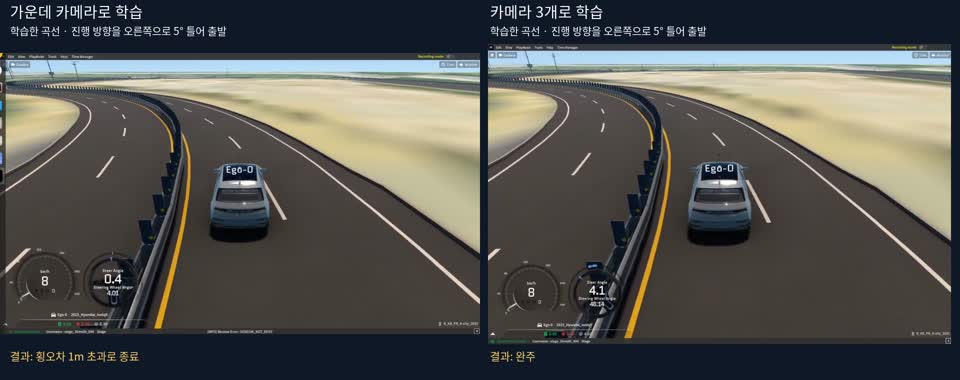

# PilotNet으로 K-City 주행하기

MORAI에서 수집한 이미지로 PilotNet을 학습하고, 실제 시뮬레이터 주행으로 평가한 프로젝트다.
**가운데 카메라로 학습한 모델**과 **좌·중·우 카메라 3개로 학습한 모델**을 비교했다.
두 모델 모두 실제 주행할 때는 **가운데 카메라 한 장**을 입력으로 사용한다. CIL은 아직 구현하지 않았다.

[대표 영상 7개](results/README.md) · [시험별 결과](results/metrics/driving_trials.csv) · [코드 실행 방법](docs/reproduction.md)

## 먼저 볼 비교

[](results/videos/03_heading_recovery.mp4)

왼쪽은 가운데 카메라로 학습한 모델, 오른쪽은 카메라 3개로 학습한 모델이다.
같은 곡선에서 오른쪽으로 5° 틀어 출발했을 때, 가운데 카메라 모델은 시험이 중단됐고
카메라 3개 모델은 복귀 후 완주했다. 영상을 누르면 실제 MORAI 녹화를 볼 수 있다.

## 실제 주행 결과

| 시험 조건 | 가운데 카메라로 학습 | 카메라 3개로 학습 |
|---|---|---|
| 학습한 직선·곡선, 정상 출발 | 모두 완주 | 모두 완주 |
| 학습한 곡선, 오른쪽으로 5° 틀어 출발 | 횡오차 초과로 종료 | 복귀 후 완주 |
| 학습하지 않은 직선 200m, 정상 출발 | 횡오차 초과로 종료 | 완주 |
| 학습하지 않은 곡선 약 232m, 정상 출발 | 횡오차 초과로 종료 | 횡오차 초과로 종료 |

목표속도는 19km/h다. 기준 경로에서 횡오차가 1m를 넘으면 시험을 종료했다.
조건별 한 번의 실행 결과이며, 같은 K-City 맵에서 확인했다.
성공 장면과 실패 장면을 함께 [영상 모음](results/README.md)에 남겼다.

추가로 **카메라 3개·곡선 비중 증가 학습**을 별도 진행했다.
곡선 샘플의 추출 기대 비중을 약 68.2%에서 77.9%로 높였지만, 직선은 완주하고 곡선은 중단됐다.
기존 모델을 보존한 채 정상 출발로 곡선·직선 각 1회만 시험했다. [추가 실험 비교](results/metrics/curve_sampling_comparison.csv)

## 기록 이미지에서의 예측 오차

| 평가한 도로 | 가운데 카메라로 학습 | 카메라 3개로 학습 |
|---|---:|---:|
| 학습한 도로의 다른 주행 | 0.000119 | 0.000158 |
| 학습하지 않은 도로 | 0.009216 | 0.007449 |

값은 곡률 RMSE(1/m)이며 낮을수록 좋다. 이미지 예측 오차와 실제 완주 여부를 함께 확인한다.
자세한 수치는 [이미지 평가 표](results/metrics/open_loop.csv)에 있다.

## 코드 구조

```text
model.py          PilotNet CNN 구조
dataset.py       이미지 로딩·전처리·정답 연결
train.py          학습과 validation 모델 선택
evaluate.py       기록 이미지에서 예측 평가
drive.py          MORAI 실시간 추론·조향·녹화
learning/         학습과 실시간 주행 보조 코드
tools/            수집·데이터 준비·시험 도구
checkpoints/      학습된 모델 3개와 학습 설정
results/          대표 영상 7개와 요약 표
docs/             수집 절차와 재현 방법
```

- [수집·센서 설정](docs/collection.md)
- [학습과 주행 실행](docs/reproduction.md)
- [모델별 가중치와 학습 기록](checkpoints/README.md)
- [학습/시험 도로 지도](results/images/course_map.png)

## 데이터와 해석 범위

원본은 사람이 아닌 **지도 Pure Pursuit 자동 teacher**로 수집했다.
이미지와 실제 조향 피드백을 시각으로 맞춘 뒤 자전거 모델로 곡률 정답을 만들었다.
학습·검증·시험은 주행 그룹 기준 4:1:1로 분리했다. 새 도로의 teacher 기록은 시험에만 사용했다.
원본 JPEG는 로컬에 보관하며, GitHub에는 분할·정답 CSV와 대표 결과를 제공한다.

좌우 카메라의 복귀 정답은 우리 구현의 PP-delta 근사다. 원 논문의 전체 증강을 그대로 재현한 것은 아니다.
교차로 실패를 모든 교차로 통과가 구조적으로 불가능하다는 결론으로 해석하지 않는다.
논문: [End to End Learning for Self-Driving Cars](https://arxiv.org/abs/1604.07316).
