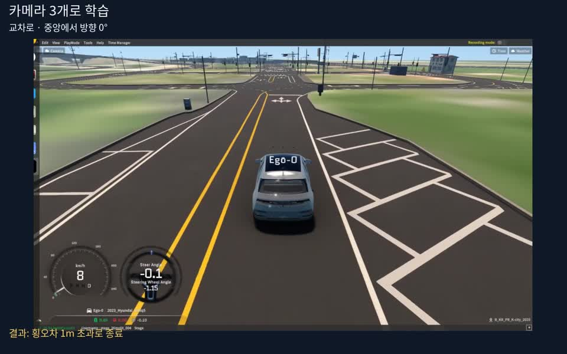

# PilotNet으로 K-City 주행하기

MORAI에서 수집한 이미지로 PilotNet을 학습하고, **학습에 사용하지 않은 도로**에서 평가한 프로젝트다.
**가운데 카메라로 학습한 모델**과 **좌·중·우 카메라 3개로 학습한 모델**을 비교했다.
두 모델 모두 실제 주행할 때는 **가운데 카메라 한 장**을 입력으로 사용한다. CIL은 아직 구현하지 않았다.

[대표 영상 4개](results/README.md) · [시험별 결과](results/metrics/driving_trials.csv) · [코드 실행 방법](docs/reproduction.md)

## 학습 도로와 시험 도로

| 용도 | 도로 | K-City 기준 경로의 진행거리 |
|---|---|---|
| 학습 데이터 수집 | 직선 | 0~65m |
| 학습 데이터 수집 | 곡선 | 640~866m |
| **시험 전용** | 새 직선 200m | **1300~1500m** |
| **시험 전용** | 새 곡선과 연결 직선 약 232m | **978.337~1210m** |

시험 도로의 이미지는 학습과 validation에 넣지 않았다.
기존 비교 영상 3개와 정량 평가 표는 위 두 시험 도로의 결과다. 교차로 사례 영상은 별도로 추가했다.
같은 K-City 맵·차량·맑은 낮 조건에서 도로 구간을 바꿨다. [도로 위치 보기](results/images/course_map.png)

## 실제 MORAI 주행 비교

[](results/videos/01_new_road_straight.mp4)

왼쪽은 가운데 카메라로 학습한 모델, 오른쪽은 카메라 3개로 학습한 모델이다.
같은 새 직선에서 정상 출발했을 때, 가운데 카메라 모델은 횡오차 기준을 넘었고 카메라 3개 모델은 완주했다.
영상을 누르면 실제 MORAI 창 녹화를 볼 수 있다.

| 정상 출발 시험 | 가운데 카메라로 학습 | 카메라 3개로 학습 |
|---|---|---|
| 새 직선 200m | 횡오차 초과로 종료 | 완주 |
| 새 곡선과 연결 직선 약 232m | 횡오차 초과로 종료 | 횡오차 초과로 종료 |

목표속도는 19km/h다. 기준 경로에서 횡오차가 1m를 넘으면 시험을 종료했다.
조건별 한 번의 실행 결과이며, 좌우 0.3m 치우침과 헤딩 ±5° 출발 결과도 [주행 평가 표](results/metrics/driving_trials.csv)에 남겼다.
정상 출발 비교와 추가 학습 실험 영상 3개에 교차로 사례를 더해 [영상 4개](results/README.md)를 제공한다.

추가로 **카메라 3개·곡선 비중 증가 학습**을 별도 진행했다.
곡선 샘플의 추출 기대 비중을 약 68.2%에서 77.9%로 높였지만, 새 직선은 완주하고 새 곡선은 중단됐다.
기존 모델을 보존한 채 정상 출발로 곡선·직선 각 1회만 시험했다.
이 추가 실험은 baseline 결과를 본 뒤 같은 시험 도로에서 진행한 탐색 비교다. [추가 실험 비교](results/metrics/curve_sampling_comparison.csv)

## 교차로 사례에서 CIL로

[](results/videos/04_intersection.mp4)

카메라 3개로 학습한 모델이 좌회전 평가 경로에서 직진 방향으로 진행하다가 횡오차 기준을 넘어 중단됐다.
PilotNet에는 원하는 진행 방향을 지정하는 입력이 없다. 다음 CIL 구현에서는 명령을 입력해
같은 교차로에서 좌회전·직진·우회전을 선택하는 주행을 확인할 계획이다.

이 교차로 J(s40~108m)는 학습 수집 구간(s0~65m)과 일부 겹치므로, 위 새 도로 정량 평가와 별도의 사례로 기록한다.
[교차로 기록 수치](results/metrics/intersection_example.csv)

## 기록 이미지에서의 예측 오차

학습하지 않은 두 도로에서 수집한 **동일한 가운데 카메라 이미지 830장**으로 평가했다.

| 지표 | 가운데 카메라로 학습 | 카메라 3개로 학습 |
|---|---:|---:|
| 곡률 RMSE (1/m) | 0.009216 | 0.007449 |
| 곡률 MAE (1/m) | 0.005665 | 0.005595 |

낮을수록 좋다. 이미지 예측 오차와 실제 완주 여부를 함께 확인한다.
자세한 수치는 [이미지 평가 표](results/metrics/open_loop.csv)에 있다.

## 코드 구조

```text
model.py          PilotNet CNN 구조
dataset.py        이미지 로딩·전처리·정답 연결
train.py          학습과 validation 모델 선택
evaluate.py       학습 도로의 내부 검증
drive.py          MORAI 실시간 추론·조향·녹화
learning/         학습과 실시간 주행 보조 코드
tools/            수집·데이터 준비·새 도로 평가 도구
checkpoints/      학습된 모델 3개와 학습 설정
results/          대표 영상 4개와 요약 표
docs/             수집 절차와 재현 방법
```

- [수집·센서 설정](docs/collection.md)
- [학습과 새 도로 평가 실행](docs/reproduction.md)
- [모델별 가중치와 학습 기록](checkpoints/README.md)

## 데이터 구성

원본은 **지도 Pure Pursuit 자동 teacher**로 수집했다.
이미지와 실제 조향 피드백을 시각으로 맞춘 뒤 자전거 모델로 곡률 정답을 만들었다.
기존 수집 그룹은 4:1:1로 나눴다. 이때 만든 `dataset/paired/test.csv`는 학습 도로의 다른 주행이므로
내부 점검용으로 보존한다. 공개 시험에는 별도로 수집한 `dataset/unseen_paired/test.csv`를 사용한다.
새 도로의 teacher 기록은 시험에만 사용했다.

원본 JPEG와 과거 내부 점검 영상은 로컬에 보관한다. GitHub에는 분할·정답 CSV와 새 도로의 대표 결과를 제공한다.
좌우 카메라의 복귀 정답은 우리 구현의 PP-delta 근사다. 원 논문의 전체 증강을 그대로 재현한 것은 아니다.
논문: [End to End Learning for Self-Driving Cars](https://arxiv.org/abs/1604.07316).
