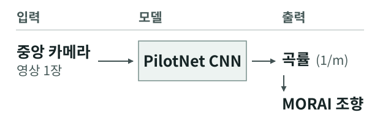
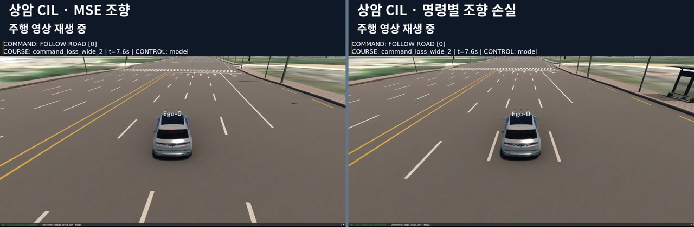

# PilotNet & CIL in MORAI K-City

카메라 영상으로 주행을 학습하면 어디까지 갈 수 있을까? MORAI K-City에서 직접 시범 주행 데이터를 수집하고, PilotNet과 Conditional Imitation Learning(CIL)을 PyTorch로 구현했다. 먼저 영상으로 조향을 예측해 직선과 곡선에서 주행했고, 이후 교차로에서 원하는 방향을 전달하는 모델을 시험했다.

## 교차로 주행 데모

https://github.com/user-attachments/assets/29a55b91-5d2b-4a81-ab3a-1780c281a0f6

같은 교차로의 좌회전 경로에서 왼쪽 PilotNet은 직진 방향으로 진행했고, 오른쪽 CIL은 `LEFT` 명령에 따라 좌회전해 종점 구간에 도달했다. 두 주행은 따로 녹화했으며, 먼저 끝난 왼쪽 영상은 마지막 화면에서 멈춘다.

## PilotNet으로 조향 학습하기

PilotNet 논문은 카메라 영상에서 조향에 필요한 값을 학습하는 방법을 제안했다. MORAI에서는 Pure Pursuit로 시범 주행을 수집하고, 영상과 차량 상태의 시각을 맞춰 curvature target을 만들었다.

중앙 카메라만으로 학습한 모델과 좌·중·우 카메라로 학습한 모델을 비교했다. 두 모델 모두 주행 중에는 중앙 영상 한 장만 입력받는다. 주행 속도는 별도의 목표속도 제어기가 맞춘다.

| 학습에 쓰지 않은 시험 구간 | 중앙 카메라로 학습 | 3카메라로 학습 |
|---|---|---|
| 직선 200 m | 횡오차로 중단 | 종점 구간 도달 |
| 곡선·연결도로 약 232 m | 횡오차로 중단 | 횡오차로 중단 |

각 모델로 구간별 한 번씩 시험했다. 아래 두 비교 영상에서 왼쪽은 중앙 카메라로, 오른쪽은 3카메라로 학습한 모델이다.

직선 200 m에서는 중앙 카메라 모델은 경로를 이탈했고, 3카메라 모델은 종점 구간에 도달했다.

https://github.com/user-attachments/assets/096a658d-96da-4768-b581-1f41538266f7

곡선·연결도로에서는 두 모델 모두 경로를 이탈했다.

https://github.com/user-attachments/assets/8a0d8432-1fd0-4297-a44d-84c379cf6832

교차로에서는 진행 방향을 지정하는 문제가 남았다. 좌회전 경로를 기준으로 시험했지만 차량은 직진 방향으로 진행했고, 모델에는 좌회전 목표를 전달할 입력이 없었다. [PilotNet 전체 결과와 주행 영상](pilotnet/results/README.md)

## CIL에 진행 방향 전달하기

CIL 논문은 교차로에서 주행 정책에 원하는 방향을 알려주기 위해 high-level command를 추가했다. MORAI에서는 영상, 속도, command, control targets를 같은 시각에 맞춰 학습했다.

`MGeo` 도로 지도의 경로에서 얻은 command로 도로 추종, 교차로 직진, 좌회전, 우회전 중 어느 branch를 사용할지 정한다.

학습과 검증에 쓰지 않은 교차로에서 같은 위치를 출발점으로 두고, 기본 CIL 모델에 직진·좌회전·우회전 명령을 각각 한 번씩 줬다.

| Command | 주행 결과 | 최대 횡오차 |
|---|---|---:|
| 직진 | 종점 구간 도달 | 2.36 m |
| 좌회전 | 종점 구간 도달 | 1.32 m |
| 우회전 | 약 61 m 중 45 m 지점에서 중단 | 7.01 m |

**CIL 곡선 주행 영상**

CIL은 시범 수집 때 조향에 Noise Injection을 적용해 경로에서 벗어난 차량을 되돌리는 조향도 학습했다. 다른 도로의 시범을 추가해 재학습한 모델은 PilotNet이 이탈한 곡선·연결도로 약 232 m를 조향 보조 없이 주행해 종점 구간에 도달했다. 최대 횡오차는 0.65 m였다.

https://github.com/user-attachments/assets/6d53fb0e-0b20-41b6-929e-d573456649d6

종점 도달은 기준 경로의 마지막 1 m 구간을 기준으로 판정했다. 횡오차 7 m는 주행 관찰을 위한 중단 기준이었다. 신호 대응, 차선 준수, 충돌 여부는 이번 평가 범위에 포함하지 않았다. [CIL 전체 결과와 주행 영상](cil/results/README.md#주행-영상)

## Point-to-point 주행

### K-City · 급우회전에서 시작한 질문

452.2 m 코스의 첫 우회전에서 초기 CIL은 **85.6 m**에 멈췄다. `RIGHT` 안에서 급회전·복귀 장면을 보강한 뒤에는 같은 20 km/h 조건에서 첫 우회전을 통과했다. 마지막 보강 모델의 영상은 **431.7 m(95.5%)**를 기록한 15 km/h 주행이다. 초반 좌회전에 조향 보조가 한 차례 있었고 마지막 우회전에서 중단됐다. [K-City 주행 영상](https://github.com/user-attachments/assets/09ff4530-aac9-40cc-8a8e-d570d66a26ad) · [조건별 기록](cil/results/README.md#point-to-point-주행)

같은 코스의 실패를 보고 학습 데이터를 고르는 과정에서, 관찰하지 않은 도로에서도 회전에 필요한 조향을 예측할 수 있는지 궁금해졌다. 새 MORAI 상암 맵에서 기존 K-City 가중치를 그대로 시험하고, 상암 데이터로 학습한 두 모델도 비교했다.

### 상암 · 명령별 조향 손실 시험

같은 우회전 명령에도 코너와 차량 자세에 따라 필요한 각도가 다르다. 이를 반영해 조향을 17개 각도 구간의 확률로 학습했다. 모든 명령에서 분포를 쓴 첫 실험에서는 우회전 개선과 직진 실패가 함께 나왔다. [첫 상암 실험](cil/sangam_study.md)

직진·차선 유지에는 조향 분포의 평균을 회귀하고, 좌·우회전에는 정답에서 먼 후보의 확률에 더 큰 손실을 주도록 바꿨다. 두 상암 모델은 같은 시범 이미지 **81,208장**과 같은 학습 예산을 사용했다. [CIL 논문](https://arxiv.org/abs/1710.02410) · [조건과 재현](cil/sangam_command_loss.md)

**왕복 4차선 이상 · 2코스 × 2회.** 각 코스에서 교차로 두 곳을 지나고, 학습 위치와 시험 중심선 사이는 최소 51.5 m였다.

| 모델 | 첫 횡오차 2.2 m까지 평균 거리 | 경로 근처 진행률 | 목적지 도달 |
|---|---:|---:|---:|
| K-City CIL 그대로 적용 | 17.9 m | 43.2% | 0/4 |
| 상암 MSE CIL | 43.3 m | 30.1% | 0/4 |
| 상암 명령별 조향 손실 CIL | **91.7 m** | 52.2% | 0/4 |

두 코스의 네 번 모두 명령별 모델의 첫 횡오차 2.2 m 지점이 두 기준형보다 뒤에 있었다. 경로 근처 진행률은 차량이 기준 경로에서 2.2 m 이내에 있었던 최장 지점을 사용했다. 실제 횡오차 중단 기준은 15 m였다.

**직진 → 좌회전 코스 · 첫 번째 실행.** [동일 데이터 MSE 비교 영상](cil/results/videos/command_loss_wide_2_vs_baseline.mp4) · [기존 GitHub 모델 비교 영상](cil/results/videos/command_loss_wide_2_vs_original.mp4) · [다른 코스의 영상과 기록](cil/sangam_command_loss.md#추가-본시험)

### 한계와 다음 실험

우회전 → 직진 코스에서는 최초 이탈 뒤 기준 경로에 다시 가까워진 기존 K-City 모델이 더 멀리 진행했다. 최종 재시험에서 세 모델 모두 교차로 출구 정렬 기준과 목적지 도달 기준을 충족하지 못했다. [코스별 거리와 횡오차 그래프](cil/sangam_command_loss.md#추가-본시험)

초기 상암 갈림길에서 모델은 `FOLLOW ROAD` 명령을 받고 직진 차로를 유지했다. 기준 경로는 오른쪽으로 이어졌고 두 모델 모두 그 코스를 끝내지 못했다. 갈림길의 출구를 전달할 시점과 연속 영상의 활용을 후속 실험에서 검증할 계획이다. [갈림길 실패 비교 영상](cil/results/videos/sangam_fork_failure.mp4) · [실제 궤적](cil/results/images/sangam_fork_trajectory.png)

## 실행과 재현

- [PilotNet 실행 및 재현 절차](pilotnet/docs/reproduction.md)
- [CIL 설치·학습·주행 절차](cil/README.md#설치와-경로-확인)

설치 후 저장소 루트에서 `bash run.sh cil drive.py --course J_left --describe`를 실행하면 좌회전 시험 경로 설정을 확인할 수 있다. CIL 차량 제어에는 MORAI 센서·통신 설정과 학습 가중치가 필요하다.

## 참고 논문

- Bojarski et al., [End to End Learning for Self-Driving Cars](https://arxiv.org/abs/1604.07316)
- Codevilla et al., [End-to-end Driving via Conditional Imitation Learning](https://arxiv.org/abs/1710.02410)
