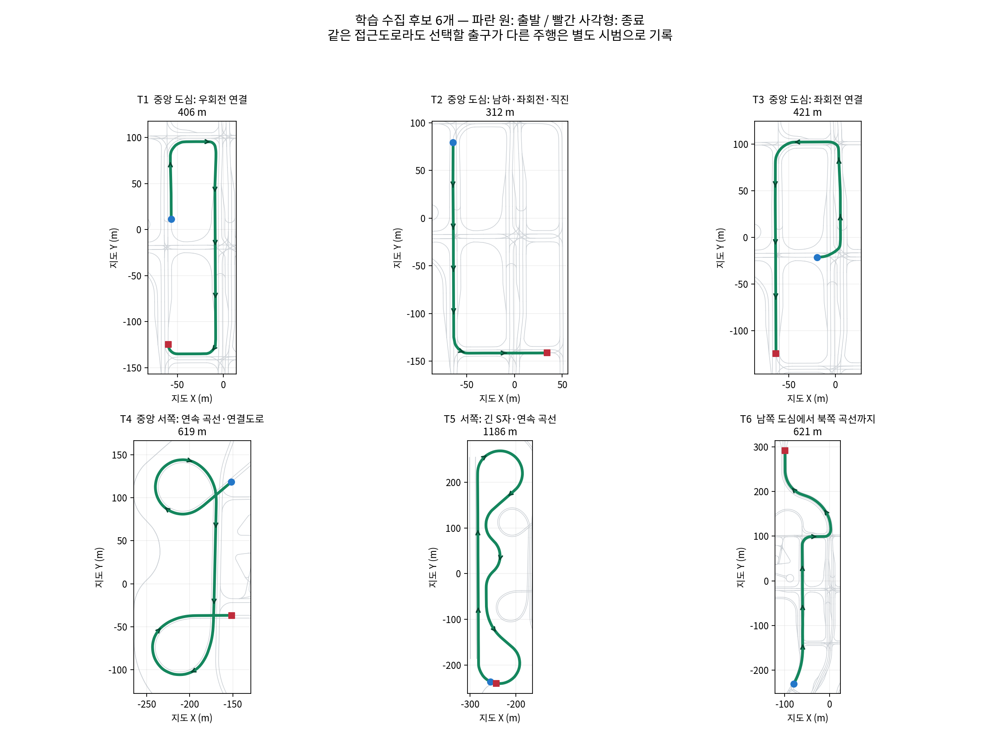

# Conditional Imitation Learning in MORAI K-City

**현재 단계: Baseline best 19 epoch를 고정해 미학습 도로의 MORAI 주행 5개를 기록했다. CTE 7m 관찰 기준에서 교차로 직진·좌회전은 종점에 도달했고, 곡선·우회전·P→Q는 기준을 넘어 중단됐다. [실제 영상과 결과](results/README.md).**

전방 이미지·현재 속도·진행 명령을 입력하고, 명령에 해당하는 branch에서 조향·가속 페달·브레이크를 예측한다.
모델 구조는 [CIL 논문](https://arxiv.org/abs/1710.02410)을 참고한다.
기존 [PilotNet 구현과 결과](../pilotnet/README.md)는 별도 폴더에 보관한다.

## 파일과 작성 순서

`config.json`부터 `drive.py`까지 작성했다. 학습·평가·실제 주행 코드를 분리한다.
`prepare.py`는 원본을 시각 매칭해 입력·정답 CSV를 만든다. `dataset.py`는 학습 중 이 CSV를 읽고 영상을 전처리·증강한다.

| 순서 | 파일 | 역할 |
|---|---|---|
| 1 | `config.json` | 센서·포트·명령 코드·수집 설정 |
| 2 | `morai.py` | 카메라·차량 상태 수신과 차량 제어 명령 송신 |
| 3 | `collect.py` | teacher 주행·진행 명령·조향 교란·복귀 시범 기록 |
| 4 | `prepare.py` | 품질 검사·시각 매칭·복귀 정답 생성·데이터 분할 |
| 5 | `dataset.py` | 이미지·속도·명령·정답 로딩, 전처리·영상 증강 |
| 6 | `model.py` | 이미지·속도 encoder와 명령별 control branch |
| 7 | `train.py` | 학습·validation·가중치 저장 |
| 8 | `evaluate.py` | 저장 모델의 이미지별 예측·Validation 재평가·오차 분석 |
| 9 | `drive.py` | MORAI closed-loop 주행과 실제 창 영상 기록 |

```text
cil/
├── README.md
├── config.json                 # CIL 전용 설정
├── morai.py                    # UDP 수신·송신
├── collect.py                  # Teacher 정상·복귀 수집
├── prepare.py                  # 정답 보정·고정 train/val 목록 생성
├── dataset.py                  # 학습 중 영상 전처리·증강·텐서 로딩
├── model.py                    # 이미지·현재 속도·명령 → 제어값과 보조 속도
├── train.py                    # 명령별 균형 추출·학습·검증·가중치 저장
├── evaluate.py                 # 이미지별 예측 CSV·명령별 오차·비교 그래프
├── drive.py                    # 가운데 영상·속도·명령으로 실제 MORAI 제어
├── tools/                      # 수집 실행을 돕는 도구
│   ├── simulator.py            # 로컬 MORAI API로 출발점 배치
│   ├── build_collection_routes.py # 명령별 경로와 시험 구역 분리 검사
│   ├── collect_all.py          # 목적별 수집·검사 및 중단 후 재개
│   ├── inspect_collection.py   # 시각·이미지·추종·시험 구역 침범 검사
│   ├── summarize_collection.py # 통과한 원본의 시간·분포·품질 집계
│   ├── summarize_training.py   # 완료·사용자 중지 학습의 곡선·Validation 표
│   ├── diagnose_training.py    # 같은 평가 조건에서 학습·Validation 오차 진단
│   ├── compare_training.py     # 고정 Validation으로 하이퍼파라미터 비교
│   ├── recording.py            # 실제 MORAI 창과 가운데 영상 녹화
│   └── summarize_driving.py    # 저장된 주행 로그의 표·궤적·무결성 확인
├── tests/                      # 통신·정답 준비·학습 로직 검사
├── assets/
│   ├── training_routes.png     # 초기 후보 그림; T5는 현재 점검 전용
│   └── morai_api.desc          # 로컬 시뮬레이터 API 메시지 정의
├── routes/
│   ├── README.md
│   ├── plan.json
│   ├── train/                 # T1~T4·T6와 동일 접근로 좌/직/우 경로
│   ├── val/                   # V1~V2
│   └── test/                  # P→Q 후보; 기존 시험 구역은 plan.json에 보존
├── data/
│   ├── collection_completion.json # 수집 통과 목록과 현재 진행 상태
│   ├── raw/                   # 수집한 원본 이미지·차량 상태·teacher 명령
│   └── prepared/              # 입력·정답 쌍의 CSV
├── runs/                      # 실행 로그·학습 곡선·설정
├── checkpoints/               # 학습한 CIL 가중치
└── results/                   # 공개할 영상·이미지·평가 표
```

원본 `data/raw/`, 정답 `data/prepared/`, `runs/`, `checkpoints/`는 로컬 실험 공간이며 Git에서 제외한다.
작은 수집 요약과 코드·경로·선정한 결과만 공개 대상으로 둔다.
루트 실행기 `bash run.sh cil <파일.py>`는 CIL 폴더를 기준으로 실행한다.

## 카메라 설정

| 역할 | MORAI 센서 | X (m) | Y (m) | Z (m) | Roll | Pitch | Yaw | 수신 포트 |
|---|---|---:|---:|---:|---:|---:|---:|---:|
| 왼쪽 | Camera_2 | 2.60 | +0.40 | 1.18 | 0° | 2° | +30° | 9096 |
| 가운데 | Camera_4 | 2.60 | 0.00 | 1.18 | 0° | 2° | 0° | 9105 |
| 오른쪽 | Camera_3 | 2.60 | −0.40 | 1.18 | 0° | 2° | −30° | 9097 |

가운데 카메라의 장착 위치·회전·화각은 PilotNet 수집 설정과 같다.
세 카메라 공통 설정은 1280×720, Horizontal FOV 90°, 30Hz, Compression Ratio 90, 일반 RGB다.
좌우 카메라가 각각 왼쪽 앞·오른쪽 앞을 보는지 View에서 확인한다.

좌우 회전 영상의 정답에는 카메라의 횡위치와 Yaw를 모두 고려해야 한다.
수집 중에는 교란을 더한 실제 명령과, 교란된 현재 상태에서 teacher가 계산한 복귀 제어를 따로 기록한다.

## 수집 경로와 시험 구역



[경로와 좌표 안내](routes/README.md)

- 학습: 차선이 있는 T1·T2·T3·T4·T6와, 같은 접근로에서 출구가 다른 좌회전·직진·우회전 시범을 사용한다.
- T5는 차선 없는 넓은 도로로, 15초 통신·추종 점검 기록만 보존하며 학습·validation에서 제외한다. 초기 후보 CSV는 보존한다.
- Validation: 별도 V1·V2 경로를 사용한다.
- 기존 시험: U1(s1300~1500m), U2(s978.337~1210m), J(s40~108m 및 세 방향 출구)를 CIL 학습·validation에서 제외한다.
- 새 시험: 수집에 사용하지 않는 북서쪽 P→Q 경로를 보존한다.
- PilotNet 학습 도로는 CIL 학습에 사용할 수 있다. J와 실제로 겹치는 부분은 제외한다.

명령은 일반 곡선의 조향 부호가 아니라, 선택한 교차로 링크의 진입·진출 방향으로 부여한다.
일반 도로 곡선에서는 `follow_road`를 유지한다. 교차로 18m 전부터 선택한 명령을 기록한다.
지도 경로와 실제 수집 위치 모두 시험·validation 보호 구역과의 최소 거리를 검사한다.

## 수집과 원본 검사

2026-11-16 기준 [수집 요약](data/collection_summary.json), [세션별 표](data/collection_summary.csv):

| 용도 | 세션 | 유효 주행시간 |
|---|---:|---:|
| 학습 정상 주행 | 8 | 8분 44초 |
| 학습 교란·복귀 | 4 | 6분 16초 |
| Validation | 2 | 2분 35초 |

총 14세션의 원본 이미지 101,745장(카메라별 33,915장)을 모두 해독·해상도 검사했다.
실제 교란이 들어간 사건은 15건이다. 이는 자동 Teacher 원본의 품질 기록이며 CIL 평가 성능이 아니다.
학습 시간은 임의 수집 종료를 위한 제동을 제외한 값이고, 보관한 원본 영상 수에는 그 구간도 포함한다.

```bash
# 차량을 움직이지 않고 실제 센서 수신 확인
bash run.sh cil morai.py

# 실제 주행 없이 경로·명령 구간 확인
bash run.sh cil collect.py --route CENTRAL_LEFT --describe

# 로컬 MORAI를 출발점에 배치한 뒤 정상 Teacher 수집
bash run.sh cil collect.py --route T1 --auto-reset

# 학습 경로의 교란·복귀 시범 수집
bash run.sh cil collect.py --route T4 --auto-reset --noise --seed 31

# 정상·명령·복귀 시범을 수집하고 모든 JPEG 검사; 기존 성공 수집은 재사용
bash run.sh cil tools/collect_all.py --resume
```

수집기는 최고 20km/h, 기본 순항 목표 19km/h로 지도 PP Teacher를 실행한다.
곡선은 감속하며, 실제 상태에서 Teacher를 다시 계산한다. 사람이 운전한 데이터로 표시하지 않는다.
교란은 학습 경로의 적합한 일반 도로에서만 주입하고, Teacher 정답과 교란이 더해진 전송 명령을 분리한다.
시각은 센서 시각과 PC 수신·송신 시각을 각각 기록한다. 센서 중단·추종 이상·저장 실패는 수집을 중단한다.

각 원본 세션은 `images/{left,center,right}/`, `images.csv`, `vehicle.csv`, `commands.csv`,
`session.json`, 실행 코드 사본 `software/`를 포함한다. 검사 후 `quality_report.json`도 생성한다.
명령 CSV의 `teacher_*`가 학습 정답 원본이고 `applied_*`는 실제 전송값이다.
임의로 정한 수집 경로 끝에서의 감속은 `label_valid=0`으로 표시해 일반 주행 정답에서 제외한다.

통과 조건은 모든 JPEG 해독·해상도, 센서 주기·시각 대응, 제어 범위, 추종 오차,
실제 수집 위치와 보호 구역의 거리다. 충돌 이벤트의 정답 로그는 수집하지 않았으므로
이 검사 통과를 무충돌 증명이나 CIL 모델 주행 성능으로 해석하지 않는다.

## 입력·정답 준비 완료

`prepare.py`로 100ms 시간칸마다 유효 영상을 고르고 상태·Teacher를 같은 센서 시각으로 맞췄다.
가장 가까운 상태의 허용 차이는 25ms, 앞뒤 보간 표본의 허용 간격은 50ms다.
명령 전환·임의 경로 끝 정차·가속과 제동 사이의 보간은 제외한다.
시각이 같은 중복 상태는 가장 먼저 대응한 행을 사용하고, 서로 다른 정답의 중복은 제외한다.

| 용도 | 카메라 | 샘플 수 |
|---|---|---:|
| 학습 | 가운데 | 8,988 |
| 학습 | 왼쪽 | 8,939 |
| 학습 | 오른쪽 | 8,966 |
| Validation | 가운데 | 1,549 |

학습 총 26,893샘플이다. Validation은 실제 추론 입력과 같은 가운데 영상만 사용한다.
별도 도로·세션 분할을 유지하며 U1·U2·J·P→Q의 시험 영상을 이 목록에 넣지 않았다.
샘플은 10Hz 시간칸 기준 선택이므로 실제 카메라 프레임 간격은 약간 달라질 수 있다.
원본 영상은 복사하지 않고 `data/prepared/train.csv`, `val.csv`에서 참조한다.
준비 조건·입력 해시는 `data/prepared/summary.json`, 실제 배치 로딩 확인은 `verification.json`에 보관한다.
수집 시점의 `collection_summary.json`과 이후 준비 결과를 구분한다.

좌우 정답은 카메라와 같은 평면 시점을 갖는 가상 차량에서 공통 경로점을 바라본 PP 조향 차이로 보정했다.
목표점은 진행거리 `max(6m, 현재 속도×2초)` 앞이다. 전방 장착 거리 2.6m, 횡위치 ±0.4m와 Yaw ±30°를 모두 반영한다.
원래 가운데 Teacher 조향에 이 차이를 더하고, 제어 범위를 벗어난 보정값은 잘라 넣지 않고 제외한다.
**보정 공식·2초·6m는 이번 구현의 기하학적 근사이며 원 논문에 공개된 보정식을 재현한 것은 아니다.**

`dataset.py`는 원본의 Y=280~720 영역을 잘라 RGB 200×88, 픽셀 0~1로 변환한다.
속도는 20km/h로 나누고, 정답은 곡률이 아닌 정규화 조향·가속·브레이크다.
train에서만 영상 증강을 적용한다. 학습 후 실제 주행에서도 같은 전처리를 사용해야 한다.
시각·정답·기하 보정 단위 검사 20개와 실제 2-worker DataLoader 배치 검사를 통과했다.
Validation 1,549장의 전처리·로딩도 모두 확인했다.

```bash
# 첫 준비 실행. 기존 준비 결과가 있으면 덮어쓰지 않는다.
bash run.sh cil prepare.py

# 보정 설정이나 원본이 달라졌다면 새 버전 폴더로 생성한다.
bash run.sh cil prepare.py --output data/prepared_v2

# Dataset 전처리와 실제 준비 CSV 확인
bash run.sh cil dataset.py --self-test
bash run.sh cil dataset.py --csv data/prepared/val.csv --split val
```

## 초기 모델 학습

`train.py`는 `data/prepared/train.csv`와 `val.csv`를 읽어 현재 `CILModel`을 학습한다.
학습에는 세 카메라의 각 영상을 개별 샘플로 사용하고, validation에는 가운데 영상만 사용한다.
학습 중에만 `dataset.py`의 영상 증강을 적용한다. 원본과 고정 분할은 바꾸지 않는다.

| 항목 | 설정 |
|---|---|
| Optimizer / 학습률 | Adam / 0.0002 |
| Batch | 120: `follow_road`·좌회전·직진·우회전 각 30개 |
| 명령 균형 | 명령별 복원 추출; 1 epoch = 225배치·27,000회 선택 |
| Loss | 세 정규화 제어값의 평균 MSE + 0.05 × 보조 속도 MSE |
| 최대 epoch / 조기 종료 | 30 / 검증 선택 점수 8 epoch 연속 미개선 |
| 모델 선택 | Validation의 명령별 제어 MSE 네 개를 같은 비중으로 평균 |
| Seed | 7 |

Adam·학습률·배치 크기·명령별 균등 배치는 논문을 참고했다.
제어값 세 개의 동등 가중치, 보조 속도 loss 비중, epoch·조기 종료·모델 선택 기준은 이번 구현의 설정이다.
보조 속도 정답은 이미지 시각의 실제 속도/20이며 목표속도가 아니다.
균형 복원 추출이므로 한 epoch에서 모든 학습 이미지가 반드시 한 번씩 선택되는 것은 아니다.

```bash
# 저장소 루트에서 실행한다. 같은 이름의 기존 실행은 덮어쓰지 않는다.
OMP_NUM_THREADS=4 MKL_NUM_THREADS=4 bash run.sh cil train.py \
  --epochs 30 --batch-size 120 --lr 0.0002 --aux-weight 0.05 \
  --patience 8 --workers 4 --seed 7 --device cuda --name cil_baseline_v1

# 명령 균형·손실 집계·선택한 branch의 gradient 검사
bash run.sh cil -m unittest discover -s tests -p test_training.py -v
```

`runs/<실행 이름>/settings.json`, `history.csv`, `summary.json`에 조건·지표·완료 상태를 남긴다.
`software/`에는 학습 당시 코드와 센서 설정을 복사하며 설정 파일에 코드·CSV 해시를 기록한다.
`checkpoints/<실행 이름>/best.pt`는 검증 기준 최선, `last.pt`는 마지막 epoch의 상태다.
학습 기록의 제어 MAE는 정규화 조향·페달 기준이다. 실제 차로 추종 오차나 완주율과 구분한다.

2026-11-18(KST) 초기 학습 `cil_baseline_20261117T223956Z`를 완료했다.
약 15분 13초 동안 27 epoch를 학습한 뒤 조기 종료했고, 검증 기준으로 19 epoch의 `best.pt`를 선택했다.
명령별 제어 MSE 평균은 0.005748, 전체 Validation의 정규화 조향 MAE는 0.083502다.
저장 모델을 다시 불러와 가운데 영상 1,549장을 재계산했으며 저장된 검증 지표와 모두 일치했다.
학습 로직 검사 5개도 통과했다. [학습 곡선과 상세 Validation 표](results/README.md).

## 하이퍼파라미터 비교 종료

하이퍼파라미터 비교에서는 `model.py`를 유지하고 `train.py`의 `--lr`, `--weight-decay`,
`--conv-dropout`, `--fc-dropout`, `--epochs`, `--patience`로 학습 조건만 조정한다.
Dropout은 기존 모듈의 확률만 실행 시 변경하며 층·채널·branch·활성화는 바꾸지 않는다.
기본 모델의 19/27 epoch를 가운데 카메라·증강 OFF·평가 모드로 비교했을 때,
학습 데이터의 명령별 평균 MSE는 0.001001→0.000611로 개선됐지만 Validation은 0.005748→0.006909로 커졌다.
이는 후반 학습의 일반화 악화 경향을 보여주며, 두 세트의 도로·복귀 사건 분포 차이는 남는다.
진단 수치는 기본 실행의 `generalization_diagnostic.json`에 보관한다.

비교 후보는 세 개로 한정했다. 데이터 목록·증강·명령별 배치·seed·보조 loss를 고정했다.

| 조건 | 학습률 | Weight decay | Conv / FC Dropout | 최대 epoch / patience |
|---|---:|---:|---|---|
| 기본 | 0.0002 | 0 | 0.20 / 0.50 | 30 / 8 |
| 후보 1: 낮은 학습률 + L2 | 0.0001 | 0.0001 | 0.20 / 0.50 | 40 / 10 |
| 후보 2: 후보 1 + 강한 Dropout | 0.0001 | 0.0001 | 0.25 / 0.60 | 40 / 10 |
| 후보 3: 기본 학습률 + 약한 L2 | 0.0002 | 0.00001 | 0.20 / 0.50 | 40 / 10 |

모델 선택은 기존과 같은 Validation의 명령별 평균 MSE로 했다.
후보 1·3은 비교를 중지하고 다음 단계로 진행하라는 사용자 요청으로 중단했다.
중단된 epoch는 제외하고 끝까지 완료한 epoch의 최선 모델만 비교했다.

| 조건 | 완료 / Best epoch | Validation 명령 평균 MSE | 종료 상태 |
|---|---:|---:|---|
| **기본 모델** | 27 / **19** | **0.005748** | 조기 종료·선택 유지 |
| 후보 1: 낮은 학습률 + L2 | 23 / 17 | 0.005894 | 사용자 요청 중지 |
| 후보 2: 강한 Dropout | 16 / 6 | 0.005771 | 조기 종료 |
| 후보 3: 약한 L2 | 10 / 6 | 0.006394 | 사용자 요청 중지 |

일부 후보의 전체 조향 MAE는 줄었지만, 고정한 선택 기준인 명령 평균 MSE는 기본 모델보다 낮아지지 않았다.
따라서 **`cil_baseline_20261117T223956Z/best.pt`(19 epoch)를 유지**한다.
이는 같은 Validation을 활용한 모델 선택 결과이며 독립 시험 성능이 아니다.
[비교 그래프·표·상태 기록](results/README.md)을 공개하고 전체 실행·소스 사본은 로컬에 보존한다.

```bash
# 완료된 실행의 기록·체크포인트 일치 확인과 그래프·표 생성
bash run.sh cil tools/summarize_training.py --run cil_baseline_20261117T223956Z

# 완료한 epoch의 결과만 사용해 기본 모델과 후보 세 개 비교
bash run.sh cil tools/compare_training.py \
  --runs cil_baseline_20261117T223956Z cil_tune_lr_l2_20261118 \
         cil_tune_stronger_dropout_20261118 cil_tune_mild_l2_20261118 \
  --output-name cil_hparam_tuning
```

전체 학습 기록·소스 사본·재로딩 검사 결과는 `runs/cil_baseline_20261117T223956Z/`,
가중치는 `checkpoints/cil_baseline_20261117T223956Z/`에 로컬로 보관한다.
수집·준비 검증 JSON은 각 단계 당시의 상태를 담은 기록이며 학습 완료 상태는 해당 실행의 `summary.json`으로 확인한다.

## 실제 MORAI 주행 시험: CTE 7m 관찰 기준

2026-11-18(KST), 학습·Validation에 사용하지 않은 U2·교차로 J의 세 방향·P→Q를 각각 한 번 기록했다.
선택한 **Baseline 19 epoch의 가중치를 그대로 사용**했으며 시험 기록은 재학습에 사용하지 않았다.
입력은 가운데 영상 한 장·현재 속도·진행 명령이고, CIL이 조향·가속·브레이크 세 값을 예측한다.
지도는 초기 배치·명령 선택·진행률·횡오차 측정에만 사용하며 지도 조향을 섞지 않는다.

| 시험 | 결과 | 최대 횡오차 |
|---|---|---:|
| 곡선 U2 | 약 116/232m에서 CTE 기준 초과로 중단 | 7.016m |
| J 직진 | 기준경로의 마지막 1m 구간 도달 | 2.358m |
| J 좌회전 | 기준경로의 마지막 1m 구간 도달 | 1.321m |
| J 우회전 | 약 45/61m에서 CTE 기준 초과로 중단 | 7.006m |
| 미학습 P→Q | 약 17/636m에서 CTE 기준 초과로 중단 | 7.130m |

**7m는 주행을 더 관찰하기 위해 넓힌 중단 기준이다.** 직진·좌회전의 종점 도달을 차선 유지 성공으로
해석하지 않는다. 충돌 이벤트도 계측하지 않았으므로 무충돌 결과가 아니다. 같은 K-City 맵에서
각 조건 한 번의 관찰이며 반복 시험의 통계적 성공률을 주장하지 않는다.

최종 판정은 CTE 기준을 먼저 확인하고, 기준경로의 마지막 1m 구간에 도달하면 종료 후 제동한다.
헤딩 오차만으로 별도 중단하지 않는다. [고정 시험 조건](routes/test/protocol.json)에 기록했다.
초기 CTE 1m 실행과 엄격한 종점·헤딩 조건 때문에 종료 시점을 놓친 J 직진의 점검 실행은
공개 5개 결과에서 제외하고 원본을 보존했다. U2 영상에는 이전 종점 조건이 남아 있지만,
종점 훨씬 전인 116m 지점에서 CTE 기준을 넘어 종료했으므로 종점 조건 차이가 결과에 영향을 주지 않았다.

```bash
# 차량 제어 없이 시험 경로·조건 확인
bash run.sh cil drive.py --course U2 --describe

# 실제 재시험: 초기 배치·CIL 제어·MORAI 창 녹화를 수행한다.
bash run.sh cil drive.py --course U2 --control --reset --record-screen --max-cte 7
```

[실제 MORAI 영상 5개·횡오차·궤적](results/README.md)과 [공개 상세 기록](results/metrics/closed_loop.json)을 보관한다.
원본 실행별 설정·telemetry·영상은 `runs/closed_loop/`, 검증된 5개 집계는 `runs/closed_loop_summary_cte7/`에 있다.
