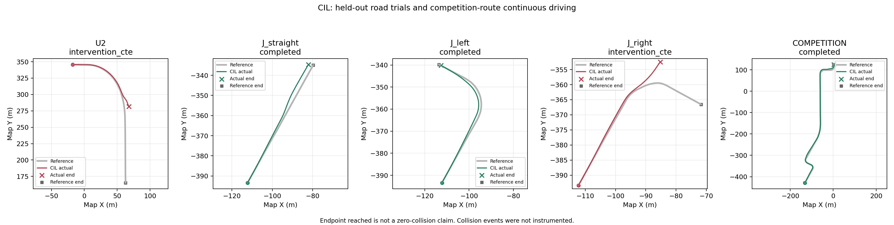

# CIL 주행과 학습 결과

검증 기준으로 선택한 기본 모델의 19번째 epoch 가중치로 MORAI에서 주행했다. 곡선 U2와 교차로 J의 세 방향은 CIL 학습·검증에 사용하지 않은 구간이다. 같은 K-City에서 조건별로 한 번씩 시험했다.

## 주행 영상

| 시험 | 관찰 결과 | 최대 횡오차 |
|---|---|---:|
| 곡선 U2 | 약 116/232 m에서 횡오차 기준으로 중단 | 7.016 m |
| 교차로 J 직진 | 종점 구간 도달 | 2.358 m |
| 교차로 J 좌회전 | 종점 구간 도달 | 1.321 m |
| 교차로 J 우회전 | 약 45/61 m에서 횡오차 기준으로 중단 | 7.006 m |

<details>
<summary>곡선 U2 · 중단</summary>

https://github.com/user-attachments/assets/d41911e4-ea73-4870-9b94-67535cfd0919

</details>

<details>
<summary>교차로 J · 직진</summary>

https://github.com/user-attachments/assets/63fbbd4e-ff00-4bc6-b5d7-b65d74dbff27

</details>

<details>
<summary>교차로 J · 좌회전</summary>

https://github.com/user-attachments/assets/b9abc75d-7825-44f3-a835-31c9f7326e68

</details>

<details>
<summary>교차로 J · 우회전</summary>

https://github.com/user-attachments/assets/c0cd68c8-ff82-48b2-9535-f95c82ce94d7

</details>

횡오차 7 m에 도달하면 중단한다. 그 전에 기준경로의 마지막 1 m 구간에 도달하면 종점 도달로 기록한다. 차선 준수와 충돌 여부는 별도의 계측이 필요하다. 녹화·프레임별 주행 로그의 출처와 SHA256을 상세 기록에 담았다. [주행 결과 CSV](metrics/closed_loop.csv) · [상세 기록](metrics/closed_loop.json) · [영상 파일](videos/)

초기에 횡오차 1 m를 적용한 점검 주행 세 건과 종점 조건 점검용 J 직진 한 건의 원본은 로컬에 있다. U2는 초기 종점 조건을 사용했으며, 기준경로 116 m 지점에서 횡오차 한계로 종료됐다.

## Point-to-point 주행

출발점과 종점을 정한 연속 명령 주행이다. 새 촬영에서 종점까지 도달한 경우와 도중에 중단된 경우는 채택한 영상과 함께 각각의 출발·종료 조건과 도달 거리를 기록할 예정이다.

<!-- 새 촬영을 공개할 때 이 문단을 결과로 교체한다. 각 시도는 실제 종료 상태와 기준거리 및 진행거리를 함께 적고, GitHub에 첨부한 영상은 URL만 한 줄에 넣는다. -->

### 기존 대회 경로 시연

대회 출발점에서 마지막 좌회전 출구 뒤 10 m까지, 약 645.1 m의 기준경로에서 연속 명령 주행을 기록했다. 약 130.4초에 기준경로의 마지막 1 m 구간에 도달했다. 최대 횡오차는 6.223 m, 횡오차 RMSE는 2.034 m, 평균속도는 17.789 km/h였다.

경로를 0.5 m 간격으로 비교했을 때 63.78%가 학습 시 차량이 주행한 위치의 3.5 m 이내였다. 경로와 겹치는 학습 도로가 있는 연속 주행 시연이다.

<details>
<summary>기존 대회 경로 · 연속 주행 영상</summary>

https://github.com/user-attachments/assets/6216f718-3e21-4d6c-bed9-246a4d155673

</details>



## 학습·Validation


| 항목 | 결과 |
|---|---:|
| 학습 / Validation 샘플 | 26,893 / 1,549 |
| 완료 / 선택 epoch | 27 / 19 |
| 학습 시간 | 약 15분 13초 |
| 명령별 제어 MSE의 동등 평균 | 0.005748 |
| 전체 Validation 제어 MSE | 0.005414 |
| 정규화 조향 MAE | 0.083502 |
| 가속 / 브레이크 MAE | 0.024260 / 0.002348 |
| 이미지 기반 보조 속도 MAE | 1.507 km/h |

학습은 세 카메라를 사용하고 Validation은 별도 도로의 가운데 카메라만 사용했다.
제어 MSE는 정규화 조향·가속·브레이크 오차 제곱의 평균이다. 조향 MAE의 단위는 정규화값이다.
모델은 Validation의 네 명령별 제어 MSE를 동등하게 평균한 점수로 선택했다.
선택 이후 8 epoch 동안 이 점수가 개선되지 않아 조기 종료했다.
저장한 모델을 다시 불러와 Validation 1,549장 전체의 지표가 재현되는지 확인했다.

Validation은 모델 선택에 사용한 세트다. 위의 미학습 도로 시험 및 학습 도로를 포함한 연속 주행 시연과 구분한다.

- [명령별 Validation 표](metrics/baseline_validation.csv)
- [학습 조건·수치·검증 요약](metrics/baseline_training_summary.json)

## 하이퍼파라미터 비교


| 조건 | 완료 / Best epoch | 명령 평균 MSE | 상태 |
|---|---:|---:|---|
| **Baseline** | 27 / **19** | **0.005748** | 조기 종료·선택 유지 |
| 낮은 학습률 + L2 | 23 / 17 | 0.005894 | 수동 중단 |
| 강한 Dropout | 16 / 6 | 0.005771 | 조기 종료 |
| 약한 L2 | 10 / 6 | 0.006394 | 수동 중단 |

모델 구조·데이터 분할·증강·명령 균형 배치는 유지하고 학습 조건만 바꿨다.
수동 중단한 두 실행은 완료한 epoch의 결과로 비교했다.
일부 후보의 전체 조향 MAE는 개선됐지만, 모델 선택 기준인 네 명령의 동등 평균 MSE는 Baseline보다 낮아지지 않았다.

- [하이퍼파라미터·제어 오차·종료 상태 비교 표](metrics/hyperparameter_comparison.csv)
- [선택 근거·고정 조건·파일 해시](metrics/hyperparameter_comparison.json)

이 비교는 **모델 선택에 사용한 동일 Validation**에서 수행했다. 독립 시험 결과가 아니다.
학습 그래프는 Dropout·증강이 적용된 값이고 Validation은 평가 모드에서 계산하므로 두 조건을 구분해야 한다.
`evaluate.py`로 선택 모델의 Validation 1,549장을 다시 예측했다. 이미지별 예측 CSV와
Teacher 비교 그래프를 저장했으며 전체·명령별 지표가 학습 당시 값과 부동소수점 허용 오차 안에서 일치했다.

저장 모델을 평가하는 명령은 저장소 루트에서 다음과 같다.

```bash
bash run.sh cil evaluate.py
```

기본 모델은 로컬 `cil/checkpoints/selected.json`에서 읽는다. 결과는
`cil/runs/evaluation/<실행 시각>/`의 `metrics.json`, `predictions.csv`, `predictions.png`다.
별도 CSV는 `--csv`로 지정할 수 있으며, 기본 Validation 결과는 독립 시험으로 취급하지 않는다.

`train.py` 작성과 실행 방법은 [학습 안내](../README.md#초기-모델-학습)에 있다.
선택한 가중치는 로컬 `cil/checkpoints/cil_baseline_20261117T223956Z/best.pt`에 보관한다.
원본 수집 기록과 전체 실행 로그는 각각 `cil/data/raw/`, `cil/runs/`에서 관리한다.

[CIL 구현·실행 안내](../README.md) · [PilotNet 주행 결과](../../pilotnet/results/README.md)
