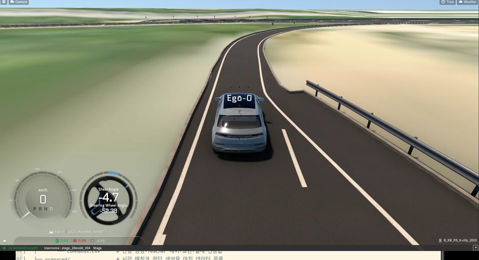
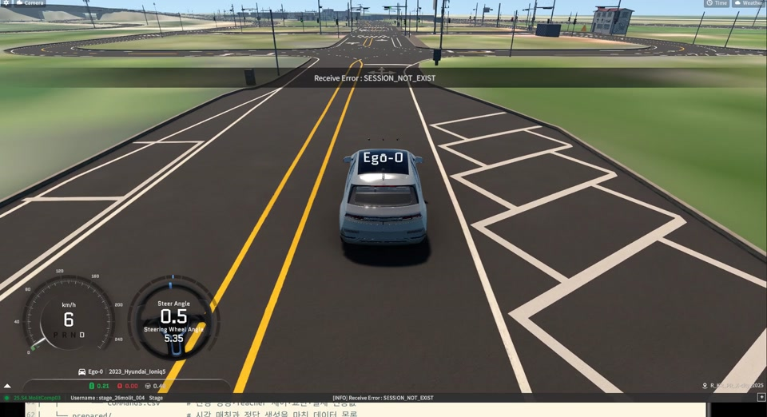
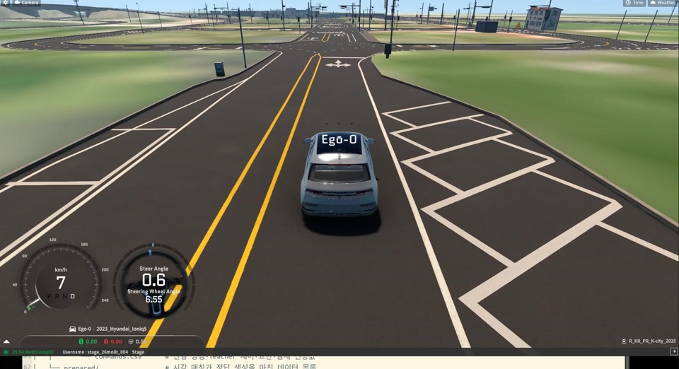
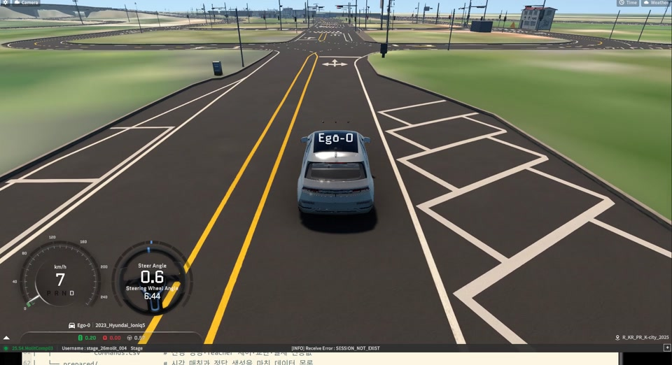
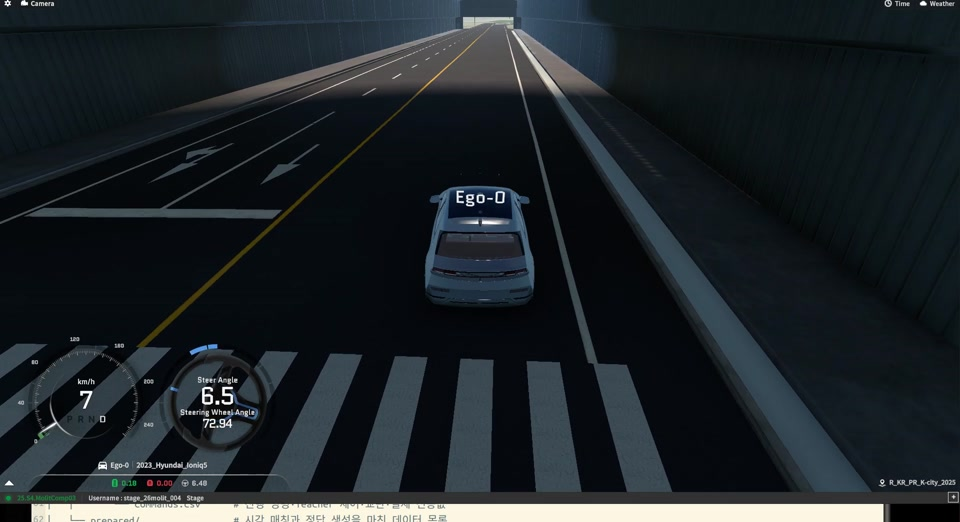
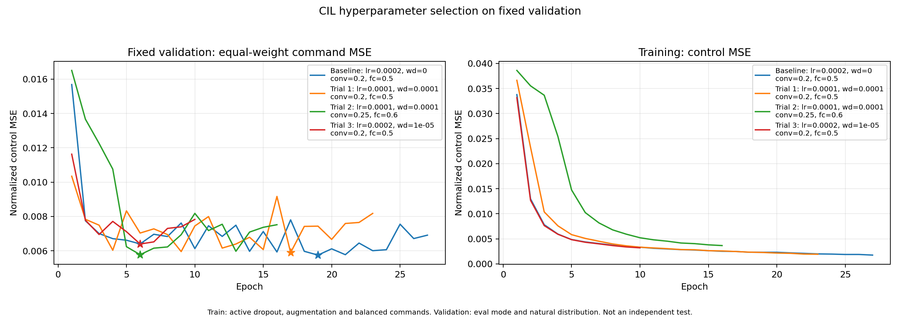

# CIL 결과

**Baseline best 19 epoch를 고정해 실제 MORAI 주행 5개를 기록했다.**
입력은 가운데 영상·현재 속도·진행 명령이고, CIL이 조향·가속·브레이크를 예측한다.
시험 구간은 학습·Validation에서 제외했으며 아래 기록을 재학습에 사용하지 않았다.

## 실제 MORAI 영상: CTE 7m 관찰 기준

| 영상 | 관찰 결과 |
|---|---|
| [](videos/01_curve.mp4) | **곡선 U2:** 약 116/232m에서 CTE 7m 기준을 넘어 중단. 최대 7.016m. |
| [](videos/02_intersection_straight.mp4) | **교차로 직진:** 종점 구간 도달. 최대 CTE **2.358m**. |
| [](videos/03_intersection_left.mp4) | **교차로 좌회전:** 종점 구간 도달. 최대 CTE **1.321m**. |
| [](videos/04_intersection_right.mp4) | **교차로 우회전:** 약 45/61m에서 CTE 7m 기준을 넘어 중단. 최대 7.006m. |
| [](videos/05_point_to_point.mp4) | **미학습 P→Q:** 약 17/636m에서 CTE 7m 기준을 넘어 중단. 최대 7.130m. |

영상은 가운데 카메라 재생을 대신 넣은 것이 아니라 **실제로 실행한 MORAI 창의 원본 녹화**다.
원본 파일을 그대로 복사했고 [상세 기록](metrics/closed_loop.json)에 각 영상의 SHA256을 남겼다.

7m는 주행을 더 관찰하기 위한 넓은 중단 기준이다. **직진·좌회전의 종점 도달은 차선 유지 성공이 아니다.**
충돌 이벤트는 계측하지 않았으므로 무충돌 결과로도 해석하지 않는다. 같은 K-City 맵에서 각 조건 한 번의
시험이며 통계적 성공률이나 다른 맵에 대한 일반화 성능을 주장하지 않는다.


- [주행 결과·영상 경로·원본 영상 해시](metrics/closed_loop.csv)
- [시험 조건·원본 로그 해시·제외 기록](metrics/closed_loop.json)

CTE 한계를 먼저 확인하고 기준경로 마지막 1m 구간에 도달하면 종료 후 제동한다.
초기 CTE 1m 실행 3개와 엄격한 종점·헤딩 조건으로 종료 시점을 놓친 J 직진 점검 실행은 이 표에서 제외하고
원본을 보존했다. U2에는 이전 종점 조건이 남아 있지만, 종점 이전 116m에서 CTE 기준을 넘어 종료했으므로
종점 판정 차이는 해당 결과에 영향을 주지 않았다.

## 학습·Validation


| 항목 | 결과 |
|---|---:|
| 학습 / Validation 샘플 | 26,893 / 1,549 |
| 완료 / 선택 epoch | 27 / 19 |
| 학습 시간 | 약 15분 13초 |
| 명령별 제어 MSE의 동등 평균 | 0.005748 |
| 전체 Validation 제어 MSE | 0.005414 |
| 정규화 조향 MAE | 0.083502 |
| 가속 / 브레이크 MAE | 0.024260 / 0.002348 |
| 이미지 기반 보조 속도 MAE | 1.507 km/h |

학습은 세 카메라를 사용하고 Validation은 별도 도로의 가운데 카메라만 사용했다.
제어 MSE는 정규화 조향·가속·브레이크 오차 제곱의 평균이다. 조향 MAE의 단위는 정규화값이다.
모델은 Validation의 네 명령별 제어 MSE를 동등하게 평균한 점수로 선택했다.
선택 이후 8 epoch 동안 이 점수가 개선되지 않아 조기 종료했다.
저장한 모델을 다시 불러와 Validation 1,549장 전체의 지표가 재현되는지 확인했다.

Validation은 모델 선택에 사용한 세트다. 위의 미학습 도로 주행 기록과 구분한다.

- [명령별 Validation 표](metrics/baseline_validation.csv)
- [학습 조건·수치·검증 요약](metrics/baseline_training_summary.json)

## 하이퍼파라미터 비교



| 조건 | 완료 / Best epoch | 명령 평균 MSE | 상태 |
|---|---:|---:|---|
| **Baseline** | 27 / **19** | **0.005748** | 조기 종료·선택 유지 |
| 낮은 학습률 + L2 | 23 / 17 | 0.005894 | 사용자 요청 중지 |
| 강한 Dropout | 16 / 6 | 0.005771 | 조기 종료 |
| 약한 L2 | 10 / 6 | 0.006394 | 사용자 요청 중지 |

모델 구조·데이터 분할·증강·명령 균형 배치는 유지하고 학습 조건만 바꿨다.
사용자 요청으로 중지한 두 실행은 마지막까지 완료한 epoch의 결과만 비교에 포함했다.
중지 상태는 `stopped_by_user`로 기록하며 정상 조기 종료와 구분한다.
일부 후보의 전체 조향 MAE는 개선됐지만, 모델 선택 기준인 네 명령의 동등 평균 MSE는 Baseline보다 낮아지지 않았다.

- [하이퍼파라미터·제어 오차·종료 상태 비교 표](metrics/hyperparameter_comparison.csv)
- [선택 근거·고정 조건·파일 해시](metrics/hyperparameter_comparison.json)

이 비교는 **모델 선택에 사용한 동일 Validation**에서 수행했다. 독립 시험 결과가 아니다.
학습 그래프는 Dropout·증강이 적용된 값이고 Validation은 평가 모드에서 계산하므로 두 조건을 구분해야 한다.
`evaluate.py`로 선택 모델의 Validation 1,549장을 다시 예측했다. 이미지별 예측 CSV와
Teacher 비교 그래프를 저장했으며 전체·명령별 지표가 학습 당시 값과 부동소수점 허용 오차 안에서 일치했다.

저장 모델을 평가하는 명령은 저장소 루트에서 다음과 같다.

```bash
bash run.sh cil evaluate.py
```

기본 모델은 로컬 `cil/checkpoints/selected.json`에서 읽는다. 결과는
`cil/runs/evaluation/<실행 시각>/`의 `metrics.json`, `predictions.csv`, `predictions.png`다.
별도 CSV는 `--csv`로 지정할 수 있으며, 기본 Validation 결과는 독립 시험으로 취급하지 않는다.

`train.py` 작성과 실행 방법은 [학습 안내](../README.md#초기-모델-학습)에 있다.
선택한 가중치는 로컬 `cil/checkpoints/cil_baseline_20261117T223956Z/best.pt`에 보관한다.
원본 수집 기록과 전체 실행 로그는 각각 `cil/data/raw/`, `cil/runs/`에서 관리한다.

[CIL 구현 계획](../README.md) · [기존 PilotNet 결과](../../pilotnet/results/README.md)
