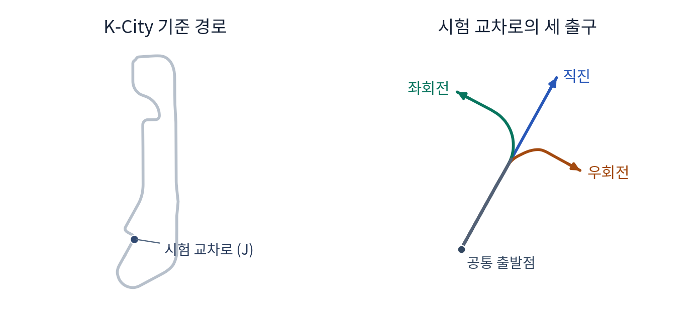
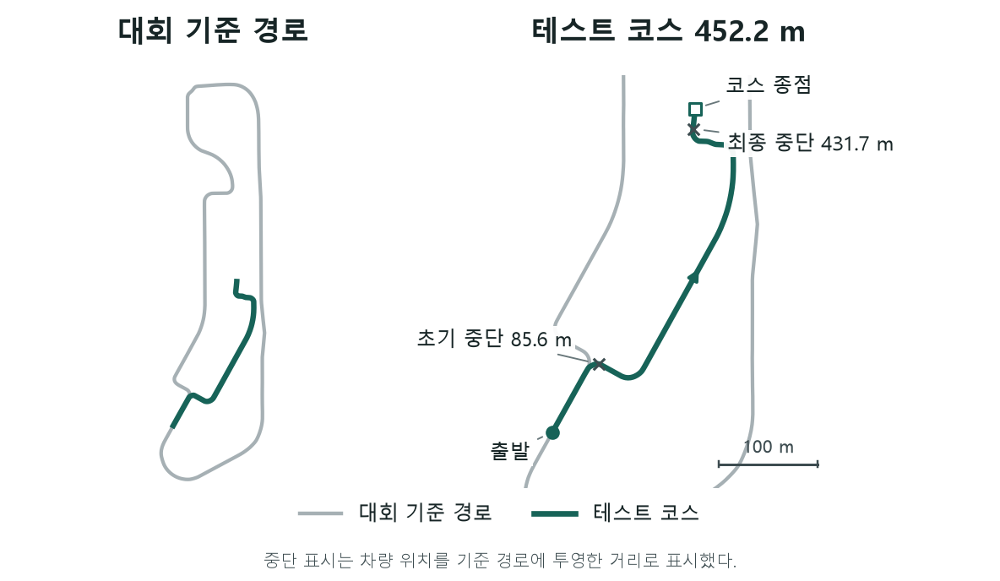
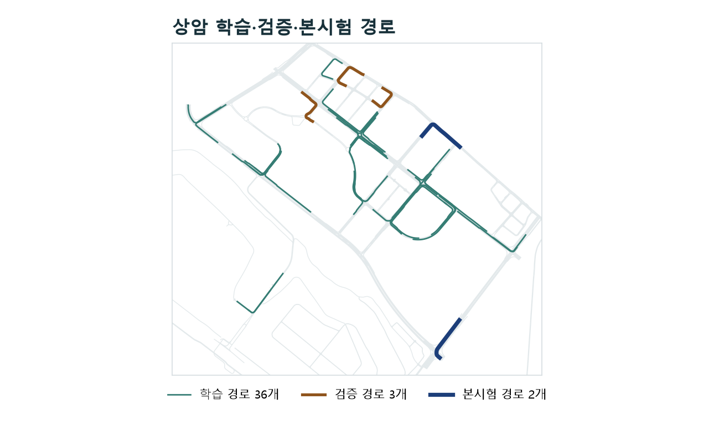
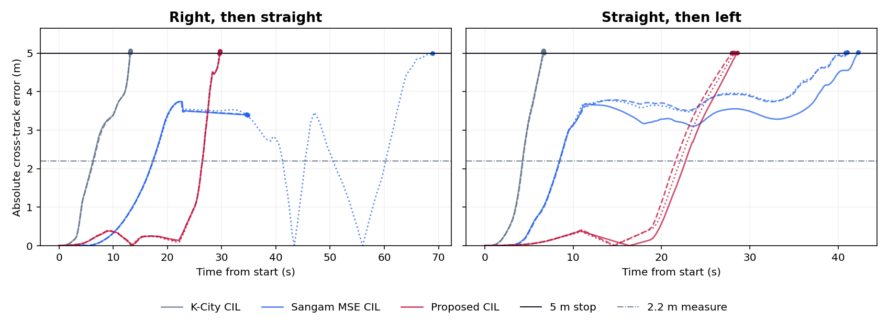
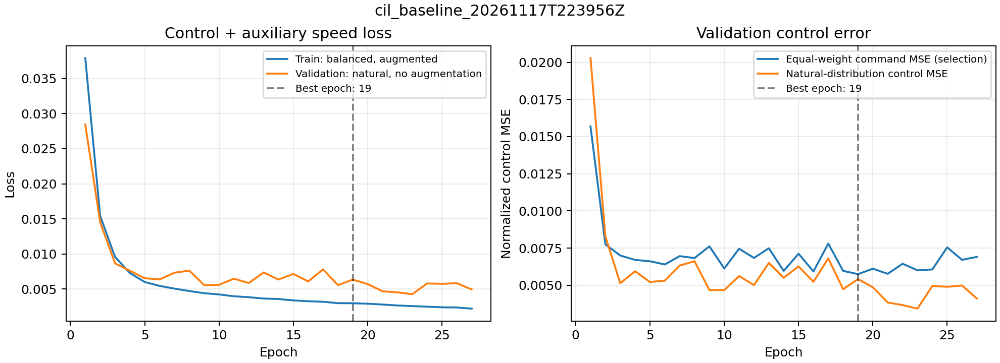

# CIL 주행과 학습 결과

MORAI K-City의 곡선·교차로 시험과 K-City·상암의 연속 주행을 기록했다. [Point-to-point 영상과 결과](#point-to-point-주행)

## 주행 영상

아래 표는 기본 CIL 모델의 곡선·교차로 시험 결과다. 학습과 검증에 쓰지 않은 도로에서 조건별로 한 번씩 주행했다.

### 시험 교차로

`J`는 K-City 기준 경로 초반에 있는 교차로다. 세 번 모두 같은 접근로의 같은 위치에서 출발해 각각 직진·좌회전·우회전 명령을 줬다. 좌회전은 첫 화면의 PilotNet–CIL 비교와 같은 경로다. [비교 영상](../../README.md#교차로-주행-데모)

| 시험 구간 | 관찰 결과 | 최대 횡오차 |
|---|---|---:|
| 곡선·연결도로 (`U2`) | 약 116/232 m에서 중단 | 7.016 m |
| 시험 교차로 · 직진 | 종점 구간 도달 | 2.358 m |
| 시험 교차로 · 좌회전 | 종점 구간 도달 | 1.321 m |
| 시험 교차로 · 우회전 | 약 45/61 m에서 중단 | 7.006 m |

횡오차는 차량이 기준 경로에서 옆으로 벗어난 거리다. 횡오차가 7 m 이상이면 주행을 중단하고, 그 전에 기준 경로의 마지막 1 m 구간에 들어가면 종점 도달로 기록했다. 차선 준수와 충돌은 별도로 계측해야 한다. [시험별 기록](metrics/closed_loop.csv) · [시험 조건](metrics/closed_loop.json)

기본 모델의 곡선·연결도로 시험 · 중단

https://github.com/user-attachments/assets/d41911e4-ea73-4870-9b94-67535cfd0919

곡선·연결도로 재시험 · 종점 구간 도달

기본 CIL은 곡선·연결도로(`U2`)의 약 116 m 지점에서 중단됐다. 다른 도로에서 좌회전·직진·우회전 시범을 더 수집해 학습 데이터의 도로 구성을 넓히고 샘플 수를 늘린 뒤, 같은 곡선에서 재시험했다. 조향 보조 없이 231.7 m 중 230.8 m까지 진행해 종점 구간에 도달했고, 최대 횡오차는 0.65 m였다.

https://github.com/user-attachments/assets/6d53fb0e-0b20-41b6-929e-d573456649d6

시험 교차로 · 직진

https://github.com/user-attachments/assets/63fbbd4e-ff00-4bc6-b5d7-b65d74dbff27

시험 교차로 · 좌회전

https://github.com/user-attachments/assets/b9abc75d-7825-44f3-a835-31c9f7326e68

시험 교차로 · 우회전

https://github.com/user-attachments/assets/c0cd68c8-ff82-48b2-9535-f95c82ce94d7

## Point-to-point 주행

### K-City에서 뭐가 달라졌나

첫 우회전에서 멈춘 뒤, 시험 경로 밖에서 모은 급우회전, 회전 중 복귀, 직진 교차로 시범을 보강했다.

| 실행 | 중단 지점 | 경로 진행률 | 속도 상한 | 조향 보조 |
|---|---|---:|---:|---|
| 초기 모델 | 첫 우회전 | 18.9% (85.6 m) | 20 km/h | 0회 |
| 보강 모델 | 마지막 우회전 | **95.5% (431.7 m)** | 15 km/h | 초반 좌회전 1회 |

진행률은 중단 위치를 기준 경로에 투영한 거리를 전체 코스 길이 452.2 m로 나눈 값이다. 두 주행의 속도 상한과 조향 보조 조건이 다르다. [비교 영상](../../README.md#k-city-연속-주행--경로-955-진행) · [경로 CSV](../routes/test/EAST_OUTER_EXTENDED.csv) · [실행·체크포인트 기록](metrics/point_to_point.json)

데이터 보강과 추가 실행 기록

| 확인 항목 | 기록 |
|---|---|
| 초기·보강 모델의 학습량 | 각각 정면 프레임 54,000장, 전체 카메라 이미지 160,891장 |
| 보강 모델의 명령별 정면 프레임 | 명령당 13,500장 (25%), 학습 배치도 명령별 균등 추출 |
| 시험 경로 밖에서 보강한 정면 프레임 | 급우회전 1,288장, 회전 복귀 304장, 직진 교차로·복귀 903장 |
| 정면 `RIGHT` 시범 중 우조향 20° 이상 | 12.9% → 16.2% |
| 이전 보강 모델 | 20 km/h 상한과 조향 보조 1회에서 84.8% (383.4 m), 후반 좌회전에서 중단 |

95.5%를 기록한 모델의 Pure Pursuit 조향 보조는 107.3 m에서 시작해 139.7 m에 CIL로 돌아왔다. 마지막 우회전에서는 횡오차가 7 m에 도달해 중단했다. 같은 체크포인트는 20 km/h 상한·무보조 실행에서 첫 우회전 85.8 m 지점에 멈췄다. 보강 데이터는 시험 경로와 최소 26.7 m 떨어져 있었고, 첫 우회전 실패를 확인한 뒤 보강 유형을 정해 같은 코스에서 재시험했다. [실행별 기록](metrics/point_to_point.json) · [데이터 기록](../sangam_study.md)

별도 곡선 코스 `U2`에서는 시범 이미지를 26,893장에서 33,003장으로 늘린 뒤, 같은 20 km/h 상한과 무보조 조건에서 116.0 m 중단이 230.8 m 종점 구간 도달로 바뀌었다. [U2 전후 영상](#주행-영상) · [K-City 데이터 비교](../sangam_study.md) · [CIL 논문](https://arxiv.org/abs/1710.02410)

### 상암에서 어디를 달렸나

K-City에서 살펴본 회전 문제를 새 도로에서 확인하려고 상암의 두 경로를 시험했다.

| 본시험 경로 | 교차로 순서 | 전체 길이 | 학습 프레임과 최단 거리 |
|---|---|---:|---:|
| [코스 1](../routes/experiments/sangam_distribution/command_loss_wide_1.csv) | 우회전 → 직진 | 344.8 m | 51.5 m |
| [코스 2](../routes/experiments/sangam_distribution/command_loss_wide_2.csv) | 직진 → 좌회전 | 315.5 m | 524.1 m |

본시험은 왕복 4차선 이상 도로에서 했다. 두 상암 모델을 학습하기 전에 시험 경로 인근 수집 경로 6개를 제외했다. 횡오차 5 m 기준 재주행은 각 모델로 두 코스를 3회씩 반복했다. [경로·명령 매니페스트](../routes/experiments/sangam_distribution/command_loss_manifest.json)

기존 K-City 모델을 MORAI 상암 311.8 m 경로에 배치했다. 횡오차 5 m 기준으로 재촬영한 실행은 20.3 m 지점에서 절대 횡오차 5.04 m로 멈췄다. [초기 탐색 전체 영상](../../README.md#상암에서-여러-교차로-주행) · [재촬영 기록](metrics/sangam_cte5_evaluation.json)

학습·검증·본시험 구간 지도

### 제안 모델은 뭘 바꿨나

같은 회전 명령에도 도로 모양과 차량 자세에 따라 필요한 조향값이 달라, 모델이 가능한 조향값 여러 개에 확률을 매기는 방식을 시험했다.

CNN과 명령별 네 분기를 유지했다. 각 분기의 마지막 선형층은 조향·가속·제동 3개에서 가속·제동 2개, 구간 점수 17개, 구간 안의 조향 보정값 17개를 내는 36개 출력으로 바꿨다. 구간 점수에는 softmax를 적용해 확률 합을 1로 맞추고, 보정값에는 tanh를 적용해 후보를 각 구간 안에 둔다. 좌·우회전 학습은 정답 구간과 구간 내 조향을 맞추고, 정답에서 먼 구간에 배정한 확률을 순서형 손실로 벌점 처리한다. 두 상암 모델은 각자의 구조로 처음부터 학습했다. [출력층 코드](../distribution_model.py) · [순서형 손실](../ordinal_model.py) · [명령별 학습 손실](../turn_ordinal_model.py)

| 모델 | 조향을 정하는 방식 | 비교 목적 |
|---|---|---|
| 기존 K-City CIL | K-City에서 학습한 조향 예측을 그대로 사용 | 상암 지도로 옮겼을 때의 주행 확인 |
| 상암 기본 CIL | 조향값 하나를 예측하고 시범과의 평균제곱오차(MSE)로 학습 | 같은 상암 데이터로 학습한 기준 모델 |
| 상암 명령별 조향 손실 CIL | 직진·도로 추종은 전체 조향 범위를 사용하고, 좌·우회전은 확률이 가장 많이 모인 범위에서 조향값을 정함 | 회전의 조향 후보를 다르게 학습하고 선택하는 방식 확인 |

#### 회전할 때 최종 조향값을 고르는 예

조향 명령의 범위(-1~1)를 **17개 구간**으로 나눴다. 모델은 한 프레임에서 구간마다 확률과 그 안에서 쓸 조향값 하나를 예측한다. **이웃한 구간**은 작은 조향값부터 큰 조향값까지 나열했을 때 바로 이어지는 구간이다.

아래는 계산을 보여주기 위해 다섯 구간만 넣은 예시다.

| 조향값 | 0.00 | 0.12 | **0.24** | **0.35** | **0.47** |
|---|---:|---:|---:|---:|---:|
| 예측 확률 | 25% | 5% | **15%** | **35%** | **20%** |

좌·우회전에서는 이어지는 세 구간씩 확률을 더한다. 이 예시에서는 45%, 55%, **70%** 중 가장 큰 묶음인 **0.24·0.35·0.47**을 고른다. 확률이 높은 값에 비중을 더 줘 평균을 낸다. (0.24 × 15 + 0.35 × 35 + 0.47 × 20) ÷ 70을 계산하면 최종 조향값은 약 **0.36**이다.

직진·도로 추종에서는 모든 구간의 확률을 반영해 평균을 낸다. 위 예시에서 전체를 평균 내면 약 **0.26**이다. 회전에서 확률이 모인 구간을 고르는 이유는 멀리 떨어진 후보까지 섞어 회전에 필요한 조향이 약해지는 경우를 줄이려는 것이다. [회전 시 조향값 계산 코드](../drive.py#L171-L176)

두 상암 모델은 같은 시범 이미지 81,208장과 같은 학습 예산을 사용했다. [모델 코드](../turn_ordinal_model.py) · [학습 조건과 재현](../sangam_command_loss.md#재현)

### 그래서 어디까지 갔나

주 지표는 절대 횡오차가 처음 2.2 m 이상으로 계측된 프레임의 기준 경로상 거리다. 아래는 코스별 3회 평균이다.

| 코스 | 기존 K-City CIL | 상암 기본 CIL | 상암 제안 CIL | 기본·제안 전체 비교 |
|---|---:|---:|---:|---|
| 우회전 → 직진 | 20.0 m | 59.2 m | **99.5 m** | [1~3회차](../../README.md#우회전--직진) |
| 직진 → 좌회전 | 10.5 m | 26.5 m | **81.3 m** | [1~3회차](../../README.md#직진--좌회전) |
| 6회 평균 | 15.3 m | 42.8 m | **90.4 m** | |

제안 모델의 거리는 같은 데이터 기본형보다 6쌍 중 6쌍에서 길었다. 세 모델 모두 목적지 도달 **0/6회**, 계획된 교차로 출구 정렬 **0/12회**였다. [실행별 CSV](metrics/sangam_cte5_trials.csv) · [조건·해시·집계](metrics/sangam_cte5_evaluation.json)

회차별 수치와 종료 이유

종료 위치는 마지막 제어 프레임을 기준 경로에 투영한 거리다. 5 m 도달, 정체 등 실제 종료 이유를 함께 표시했다.

| 코스 · 회차 | 첫 2.2 m까지 · 기본 / 제안 | 종료 위치 · 기본 / 제안 | 종료 이유 · 기본 / 제안 |
|---|---:|---:|---|
| 우회전 → 직진 · 1 | 59.2 / 99.6 m | 81.5 / 116.3 m | 정체 / 횡오차 |
| 우회전 → 직진 · 2 | 59.2 / 99.6 m | 81.6 / 115.6 m | 정체 / 횡오차 |
| 우회전 → 직진 · 3 | 59.3 / 99.4 m | 213.9 / 115.6 m | 횡오차 / 횡오차 |
| 직진 → 좌회전 · 1 | 26.3 / 84.0 m | 168.7 / 108.2 m | 횡오차 / 횡오차 |
| 직진 → 좌회전 · 2 | 26.4 / 79.1 m | 165.5 / 106.0 m | 횡오차 / 횡오차 |
| 직진 → 좌회전 · 3 | 26.6 / 80.8 m | 164.6 / 106.5 m | 횡오차 / 횡오차 |

직진 → 좌회전 코스에서 제안 모델의 첫 2.2 m 지점은 세 회차 모두 첫 직진 교차로 구간이었다. 5 m 중단 기준으로 재주행하자 최종 좌회전 교차로에 도달하기 전에 멈췄다. [영상 원본과 편집 기록](metrics/sangam_cte5_videos.json)

두 코스의 횡오차와 중단 기준

2.2 m는 초기 추종을 비교하는 지표다. 절대 횡오차가 처음 5 m 이상인 20 Hz 샘플에서 가속 0, 최대 제동을 보내고 시험을 종료했다. [프레임별 기록](metrics/sangam_cte5_telemetry.csv.gz) · [상세 비교](../sangam_command_loss.md#추가-본시험)

### 웨이포인트와 곡률 실험 기록

세 모델의 구현과 K-City 평가

주행 중 조향이 조금만 어긋나도 다음 프레임에 들어오는 장면이 달라진다. 시범에서 드물었던 위치나 방향에 놓이면 다음 조향도 틀어져 오차가 커질 수 있다. 모방학습에서 말하는 **covariate shift**와 오차 누적이다. 이번 실험을 통해 명령별 샘플 수를 맞춘 뒤에도, 각 명령 안에서 어떤 도로와 차량 상태를 학습하는지 따로 살펴야 한다는 점을 배웠다. [모방학습의 분포 이동과 DAgger](https://proceedings.mlr.press/v15/ross11a.html)

같은 `RIGHT` 안에서도 코너에 진입하는 시점과 회전 반경이 다르다. 이 차이를 학습시키기 위해 command를 차량 기준 웨이포인트로 바꿨다. 계획 경로를 따라 10·20·30·40·50 m 앞의 다섯 점을 영상과 속도에 결합하고, 하나의 제어 헤드에서 조향·가속·제동을 예측했다. Pure Pursuit 시범 제어기의 lookahead distance는 3 m였다. [시범 제어기](../collect.py#L114)

두 모델을 같은 시범 데이터로 학습하고, 속도 상한 15 km/h와 조향 보조 0회로 네 코스를 두 번씩 시험했다. 명령형 CIL은 **2/8회**, 고정 웨이포인트 모델은 **0/8회** 종점에 도달했다. 명령형이 두 번 모두 도달한 중앙 도심 코스에서 고정형은 두 번 모두 약 50 m에서 이탈했다. 이 실험에서는 입력과 제어 헤드가 함께 바뀌었으므로, 두 요소를 결합한 구조의 결과로 해석했다.

현재 속도와 MGeo 경로의 전방 곡률에 따라 목표점 거리를 조절하는 가변형도 시험했다. 급한 코너에서는 목표점을 더 가까이 배치했고, 첫 점의 거리는 3.5–6 m 범위로 제한했다. 별도의 짧은 검증 코스에서는 2/2회 도달했고, 같은 네 코스에서 종점 도달은 0/8회였다. 가변형에서는 지도가 코너에 맞춰 추종 목표를 정해 주므로 정책의 역할이 경로 추종에 가까워진다고 판단했다. 영상에서 회전 강도를 학습하는 문제에 집중하기 위해 이 방향의 실험은 여기서 마쳤다.

지도에서 계산한 굽힘을 학습 정답으로 쓰고, 영상·속도·command로 제어값과 전방 20 m의 굽힘을 함께 예측하는 모델도 시험했다. 첫 급우회전 진입 무렵 가장 큰 5 m 굽힘은 지도 기준 평균 약 35°, 모델 예측 평균 약 17°였다. 회전 중에는 우조향이 약해지다가 좌조향으로 바뀌었다. 이 모델은 정·역방향과 일반 도심을 포함한 여덟 번의 비교에서 모두 명령형 CIL보다 일찍 이탈했다.

이번에 시험한 구조에서는 코너의 굽힘을 파악하고 그 차이를 안정적인 조향과 복귀에 반영하는 데 한계가 있었다. 급우회전 학습 표본이 한 코너에 집중되어 있다는 점도 확인했다. 앞으로는 다양한 회전 반경과 차량 자세, 경로 복귀 상황을 학습할 수 있는 E2E 모델을 공부하고 구현할 계획이다.

## 학습과 검증

| 기본 모델 | 결과 |
|---|---:|
| 학습 / 검증 샘플 수 | 26,893 / 1,549 |
| 완료 / 선택 epoch | 27 / 19 |
| 검증 제어 MSE · 명령별 평균 | 0.005748 |
| 검증 조향 MAE · 정규화값 | 0.083502 |

제어 MSE는 조향·가속·제동의 제곱오차를 사용한다. 네 진행 명령의 MSE를 같은 비중으로 평균해 가중치를 선택했다. 검증 입력은 학습에 사용하지 않은 도로의 가운데 카메라 이미지다. [명령별 평가](metrics/baseline_validation.csv) · [학습 요약](metrics/baseline_training_summary.json)

## 하이퍼파라미터 비교

같은 학습·검증 데이터로 학습률, 가중치 감쇠, 드롭아웃 설정을 비교했다. 모델 선택에 사용한 명령별 평균 MSE는 기본 설정이 가장 낮았다.

| 설정 | 선택 epoch | 검증 제어 MSE · 명령별 평균 | 종료 |
|---|---:|---:|---|
| 기본 | 19 | **0.005748** | 조기 종료 |
| 낮은 학습률·L2 | 17 | 0.005894 | 수동 중단 |
| 강한 드롭아웃 | 6 | 0.005771 | 조기 종료 |
| 약한 L2 | 6 | 0.006394 | 수동 중단 |

[학습 설정과 세부 지표](metrics/hyperparameter_comparison.csv) · [CIL 학습 및 실행 방법](../README.md) · [PilotNet 주행 결과](../../pilotnet/results/README.md)
