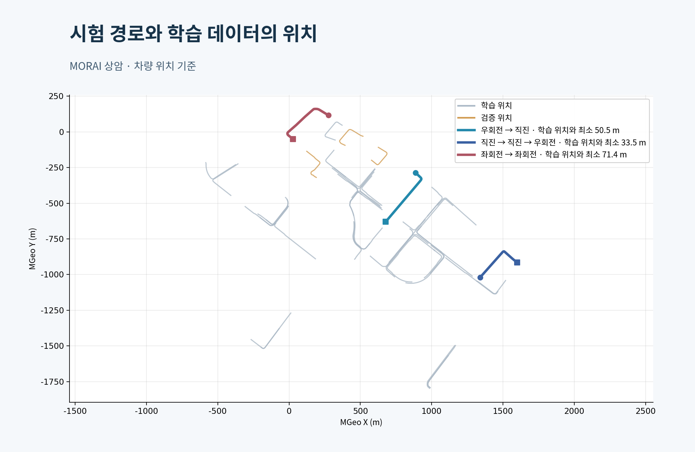

# 상암 초기 실험 · CIL의 조향 분포 비교

K-City에서 명령형 CIL을 구현한 뒤, 새 MORAI 상암 맵에서 고정된 K-City 모델과 상암에서 학습한 모델을 달렸다. 상암 안에서도 학습·검증·시험 도로를 위치로 나눴다. [상암 주행 결과 요약](results/README.md#상암에서-어디를-달렸나) · [두 코스 후속 비교](sangam_command_loss.md#추가-본시험) · [논문](https://arxiv.org/abs/1710.02410)

K-City의 정면 `RIGHT` 표본에서 우조향 20° 이상인 표본 비중은 보강 전 12.9%, 보강 후 16.2%였다. 보강 데이터의 학습 위치와 452.2 m 시험 경로의 최단 거리는 26.7 m였다. 같은 맵에서 실패를 보고 샘플 비중을 조정한 경험을 새 장소에서 재검증하는 계기로 삼았다. [K-City 재학습 기록](results/README.md#point-to-point-주행)

## 학습 조건

| 항목 | 이번 구현 |
|---|---|
| 입력과 구조 | 200 × 88 전방 영상, 실측 속도, 네 진행 명령에 따른 분기, 8층 CNN |
| 시범 수집 | MORAI 상암에서 Pure Pursuit 교사, 학습 시 중앙과 좌우 ±30° 카메라, 추론 시 중앙 카메라 |
| 동일 데이터 대조 | 학습 이미지 94,077장, 촬영 위치 42개 주행 경로, 검증 중앙 이미지 1,796장 |
| 시범 시간 | 실제 유효 조향 기록 53.0분, 조향 교란이 활성화된 수집 7.8분 |
| 최적화 | Adam, 초기 학습률 0.0002, 120장 배치에서 명령별 30장, 모델별 8,120회 업데이트 |
| 이미지 증강 | 밝기·대비·톤 변화, 블러와 잡음, 일부 사각 영역 가리기 |

논문은 CARLA Town 1에서 사람이 조종한 2시간의 시범을 수집했고 약 10%에는 조향 교란을 적용했다. 이번에는 학습 도로를 늘리고 시험 도로를 예약한 상암에서 자동 시범을 수집했다. MORAI 제어에 맞춰 조향·가속·제동을 각각 예측하고 보조 속도 예측도 사용했다. 시범 교사는 지도에서 구한 경로와 복귀 표본을 이용한다. 본시험에서 지도는 출발 배치, 범주형 진행 명령 제공, 평가에 사용했다. 주행 정책의 입력은 영상·속도·진행 명령이다. [논문의 네트워크·데이터 조건](https://arxiv.org/pdf/1710.02410)

[](results/images/sangam_arterial_split.png)

## 가설과 모델 선택

동일한 관측에 여러 조향이 대응할 때, 제곱오차의 최적 예측은 조건부 평균이다. 같은 `RIGHT`에도 도로 영상과 차량 자세에서 조향 강도를 구분할 수 있는지 확인하고 싶었다. 조향을 17개 각도 구간으로 나누고 각 구간의 확률과 구간 내 조향을 학습했다. 정답에서 먼 각도에 높은 확률을 줄수록 더 큰 손실을 적용했다. 주행에서는 확률의 합이 가장 큰 인접 세 구간 안에서 각도를 확률로 가중해 선택했다.

초기 11,228장 검증에서 가우시안 혼합분포·일반 각도 구간·채널 어텐션을 시험했다. 평균 진행률은 MSE 33.8%, 혼합분포 15.0%, 각도 구간 46.2%, 채널 어텐션 10.3%였다. 경로점을 영상에서 예측한 모델도 5.3%에서 멈췄다. 이후 22,480장으로 확장한 검증에서 순서형 조향 분포의 평균 진행률은 44.5%, 같은 데이터의 MSE는 16.0%였다. 초기 수치는 횡오차 2.2 m 조건의 별도 실험이다.

각도 구간을 학습할 때 순서를 반영하면 멀리 잘못 배정한 확률에 더 큰 손실을 줄 수 있다. 정답 0°에 70%를 준 두 예측에서 나머지 30%가 한 칸 옆에 있을 때는 누적확률 오차가 경계 하나에 나타나고, 네 칸 옆에 있을 때는 경계 네 곳에 나타난다. [손실 그림](results/images/sangam_ordinal_loss.png) · [순서형 손실 코드](ordinal_model.py) · [Ranked Probability Score](https://sites.stat.washington.edu/people/raftery/Research/PDF/Gneiting2007jasa.pdf)

추가 수집 이후에는 MSE·단순 구간·순서형 분포를 같은 데이터로 다시 학습했다. 회전 중 선택한 조향이 크게 뛰는 장면을 관찰해 연속 프레임의 확률을 평활화하는 방식과 인접한 각도 후보를 결합하는 방식도 비교했다. 별도 검증의 목적지 도달·회전 출구 정렬·첫 횡오차 2.2 m까지의 진행률 순으로 분포 모델을 정했다. MSE의 최저 검증 손실 체크포인트와 마지막 체크포인트도 같은 검증 도로에서 비교해 기준형을 골랐다.

| 모델 | 검증 도달 | 좌·우회전 출구 정렬 | 첫 횡오차 2.2 m까지의 평균 진행률 |
|---|---:|---:|---:|
| 상암 MSE CIL | 1/3 | 0 | 10.1% |
| 상암 MSE CIL · 마지막 epoch | 0/3 | 2 | 59.4% |
| 상암 순서형 조향 분포 CIL | 0/3 | 2 | 50.6% |
| 상암 순서형 조향 분포 CIL + 시간 평활화 | 0/3 | 2 | 50.7% |
| 상암 조향 구간 CIL | 0/3 | 1 | 33.0% |
| 상암 순서형 조향 분포 CIL + 인접 후보 결합 | 0/3 | 2 | 51.9% |

주행 검증 경로 한 곳은 학습 위치에 6.0 m까지 가까워지는 구간을 포함했다. 본시험 세 경로는 학습과 검증 이미지 위치에서 각각 30 m 이상 떨어져 있다.

## 본시험

영상은 서술한 모델과 코스를 유지해 다시 녹화했다. 왕복 4차선 이상의 고정된 경로에서 모델별로 한 번씩 달렸고 16 km/h 상한과 **절대 횡오차 5 m 이상 즉시 중단**을 적용했다. 각 셀은 마지막 제어 프레임의 경로상 위치와 종료 이유다.

| 코스 | 거리 | K-City CIL | 상암 MSE CIL | 상암 조향 분포 CIL |
|---|---:|---:|---:|---:|
| 우회전 → 직진 | 451.7 m | 61.4 m · 횡오차 | 121.3 m · 횡오차 | 374.3 m · 횡오차 |
| 직진 → 직진 → 우회전 | 367.8 m | 53.5 m · 횡오차 | 302.9 m · 횡오차 | 60.5 m · 횡오차 |
| 좌회전 → 좌회전 | 423.9 m | 7.5 m · 정체 | 218.9 m · 횡오차 | 98.1 m · 횡오차 |
| 좌회전 → 직진 | 345.3 m | 27.9 m · 횡오차 | 113.3 m · 횡오차 | 115.0 m · 횡오차 |

<details>
<summary>우회전 → 직진 · 동일 데이터 비교</summary>

https://github.com/user-attachments/assets/961c8d49-a388-4a03-a5af-570e41013fdd

</details>

<details>
<summary>직진 → 직진 → 우회전 · 동일 데이터 비교</summary>

https://github.com/user-attachments/assets/c89be82b-b39e-415c-abf4-271db75b7180

</details>

<details>
<summary>좌회전 → 좌회전 · 동일 데이터 비교</summary>

https://github.com/user-attachments/assets/b5a13bfc-d7f2-4afb-b1eb-4e421837509a

</details>

<details>
<summary>우회전 → 직진 · K-City 모델과 비교</summary>

https://github.com/user-attachments/assets/08041d87-ace3-4c3b-a569-ad17f7131643

</details>

[5 m 재주행 기록](results/metrics/sangam_cte5_evaluation.json) · [이전 15 m 반복 주행 기록](results/metrics/sangam_arterial_study.json)

### 추가 확인

345.3 m 좌회전 → 직진 코스도 같은 가중치로 다시 시험했다. 학습 위치와 기준 경로가 최소 64.3 m 떨어진 코스다.

<details>
<summary>좌회전 → 직진 · 추가 코스 비교</summary>

https://github.com/user-attachments/assets/f499f3cd-9319-4967-9f91-c1981fa42116

</details>

## 남은 문제

311.8 m 갈림길 경로에서 K-City 모델은 20.3 m, 초기 상암 분포 모델은 70.6 m 지점에서 횡오차 5 m 기준으로 중단했다. 갈림길의 명령 전달 시점과 연속 프레임을 활용한 복귀 동작을 후속 실험에서 확인할 부분이다. [재주행 영상](../README.md#한계) · [이전 2.2 m 시험의 궤적](results/images/sangam_fork_trajectory.png)

## 재현

상암 지도와 레거시 MORAI 카메라·UDP 연결 설정을 확인한다. [설정](routes/experiments/sangam_distribution/config.json) · [수집 경로](routes/experiments/sangam_distribution/manifest.json) · [주행 검증·시험 경로](routes/experiments/sangam_distribution/evaluation_manifest.json)

```bash
bash run.sh cil drive.py \
    --config routes/experiments/sangam_distribution/config.json \
    --manifest routes/experiments/sangam_distribution/evaluation_manifest.json \
    --course arterial_right_straight --describe

bash run.sh cil drive.py \
    --config routes/experiments/sangam_distribution/config.json \
    --manifest routes/experiments/sangam_distribution/evaluation_manifest.json \
    --course arterial_right_straight --checkpoint checkpoints/sangam_ordinal_v3/best.pt \
    --speed-cap-kph 16 --max-cte 5 --goal-max-cte 1.5 --goal-radius-m 2 \
    --control --reset --record-screen --steering-local-mode
```

학습용 이미지는 `collect.py`로 도로별 수집 후 `tools/inspect_collection.py`와 `prepare.py`로 검증·정렬한다. 각 모델 유형은 `train.py --model baseline|bins|ordinal`에서 선택하고, 공통 인자는 `--seed 7 --epochs 14 --patience 14 --steps-per-epoch 580 --batch-size 120 --lr 0.0002 --cover-samples --cache-images --paper-photometric`이다. 원본 주행 로그와 학습 가중치는 로컬 실험 기록에 저장했다.
