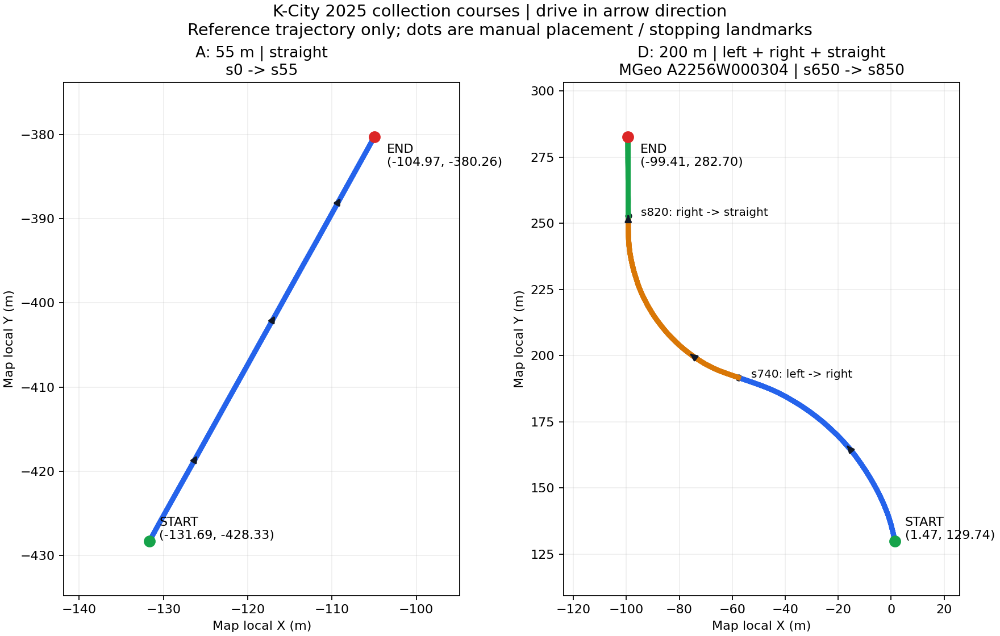

# 수집·데이터 준비 상세 안내

프로젝트의 현재 파일 구조와 직접 작성할 CNN 파일은 [루트 README](../README.md)에 정리했다.
이 문서는 수집 설정·검수·라벨 처리와 도구 사용법을 보존한 상세 안내다.
현재는 `dataset/paired/*.csv`를 읽으며 전처리하는 방식으로 진행한다.
아래 5절의 오프라인 배열 출력은 별도로 보존한 도구이며, CNN 작성 전에 실행할 필요는 없다.

이 문서에는 초기 수동 수집 절차도 보존했다. 실제 공개 실험은 **지도 PP 자동 teacher 데이터로 학습을 마치고,
별도의 새 도로 U1/U2에서 평가**했다. 현재 학습·시험 실행은 [재현 안내](reproduction.md)를 따른다.
아래 `dataset/paired/test.csv`는 같은 학습 도로의 다른 주행을 나눈 내부 점검용 목록이다.
공개 시험에는 별도 수집한 `dataset/unseen_paired/test.csv`를 사용한다.

`dataset/paired/`에는 원본 가운데 이미지 경로와 곡률 정답을 연결한 CSV가 있다.

| 파일 | 이미지–곡률 쌍 |
|---|---:|
| `dataset/paired/train.csv` | 22,890 |
| `dataset/paired/val.csv` | 5,724 |
| `dataset/paired/test.csv` | 5,724 |

각 행에서 **`image_path`가 입력 이미지, `y_curvature_1pm`가 정답 y**다. `steer_raw_deg`는 이미지 시각에 보간한 도 단위 조향각이고, `steer_raw_rad`는 이를 라디안으로 바꾼 값이다. 사용한 앞뒤 차량 상태 시각·조향각과 보간 비율도 같은 행에 있다.

현재 정답은 `-tan(steer_raw_deg × π/180) / 3.0`으로 계산했다. 왼쪽은 음수, 오른쪽은 양수이고 단위는 `1/m`다. MORAI 조향 피드백을 등가 앞바퀴 조향각으로 취급하는 자전거 모델 근사다(`road_wheel_gain=1.0`). 실제 주행궤적에서 직접 측정한 곡률과는 차이가 있을 수 있다. 학습 그룹에서 yaw rate/속도와 비교한 진단은 `dataset/paired/summary.json`에 기록했으며, 이 비교로 정답의 배율을 자동 조정하지 않았다.

매칭 조건을 충족하지 못한 가운데 영상 41장의 목록과 이유는 `dataset/paired/rejected_center.csv`에 있다. 좌우 카메라는 복귀 보정 방식을 확정한 뒤 정답을 만들도록 보류했으며, 원본과 분할 목록은 보존했다.

원본 이미지와 차량 상태 CSV는 수정하지 않았다. 30Hz 원본 프레임을 유지했고, 출발·정지 장면도 남겼다. `speed_eligible=1`은 나중에 10~30km/h 구간을 고를 때 쓸 표시다. 아직 이미지 자르기·크기 변경·YUV 변환·정규화·10Hz 샘플링은 하지 않았다.

다시 실행할 때는 새 출력 폴더를 지정한다. 기존 출력은 덮어쓰지 않는다.

```bash
python3 -m tools.preparation.build_labels --output dataset/paired_v2
```

분할 목록은 `dataset/splits/`에 있다. 같은 주행의 카메라 3대와 차량 상태 CSV가 같은 세트에 속하도록 그룹 단위로 지정했다. 원본 파일은 이동하거나 복사하지 않았다.

| 세트 | 그룹 | 주행 수 | 원본 이미지 수(카메라 3대 합계) |
|---|---|---:|---:|
| train | expert_g01~expert_g04 | 24 | 68,752 |
| val | expert_g05 | 6 | 17,188 |
| test | expert_g06 | 6 | 17,193 |

`dataset/splits/groups.json`은 그룹 배정표다. 이 폴더의 `train.csv`, `val.csv`, `test.csv`에는 이미지 경로·촬영 시각·해당 주행의 `vehicle.csv` 경로가 있다. 경로는 이 프로젝트 폴더를 기준으로 한다. 세 카메라의 원본을 모두 분류한 목록이며, 보간·곡률 변환 결과는 별도 `dataset/paired/`에 저장했다. 이후 val/test 성능 측정에는 가운데 카메라를 사용한다. `dataset/splits/summary.json`에는 원본 분할 수량과 검사 정보가 있다.

**2026-11-04 수집 완료:** 6개 그룹 × A/D 각 3회 = 36개 주행. 원본 19.1분, JPEG 103,133장(왼쪽 34,377 / 가운데 34,379 / 오른쪽 34,377), 실제 Ego 상태 57,186개. 본 수집 36개 모두 전체 JPEG 디코딩·스트림·타임스탬프·teacher 추종 검사를 통과했다. 최고 속도 19.426km/h, 최대 경로 횡오차 0.151m, 세션별 최저 영상/Ego 매칭률 99.4%, 패킷 파싱 오류 0건이다. 차량은 수집 후 P/Keyboard 모드로 주차했다.

사용할 **36개 세션의 정확한 목록은 `dataset/collection_summary.csv`**에 있다. 예전 `calibration` 세션은 Ego 라벨이 없어 본 수집에 포함하지 않으며, 설정 시험 중 제외한 세션은 `dataset/rejected/`에 별도로 보존했다. 폴더명은 UTC 시각이므로 한국 시각 11월 4일 수집분이 `20261103T…`로 시작할 수 있다.

2026-11-04 MORAI 실제 주행 수집: `expert_collect.py`가 지도 Pure Pursuit와 속도 피드백으로 A/D 코스를 주행한다. **사람의 시범 운전이 아닌 고전 제어기 teacher 데이터**다. `session.json/control.kind=map_pure_pursuit_expert_v1`, `human_steering=false`로 구분한다. 기존 수동 키보드 수집 기능도 보존했다.

수집 위치는 `dataset/raw/<세션>/`이며, 본 수집 그룹은 `expert_g01`~`expert_g06`이다. 각 그룹에서 A/D 각각 3회, 총 36개 주행을 수집한다. 모든 그룹은 같은 두 도로 구간·맑음·정오 조건의 반복 기록이며, 새로운 도로에서의 일반화 시험을 뜻하지 않는다. 시작 횡위치 0/±0.12m, 헤딩 0/±0.5°, 목표속도 18.5/19/19.5km/h 변형은 세션에 기록한다. 초기 가감속도 원본에 남긴다.

각 세션의 `quality_report.json`에 전체 JPEG 디코딩, 스트림 주기, 타임스탬프 매칭, teacher 명령 출처, 경로 오차를 검사한 결과가 있다. `dataset/collection_summary.json`과 같은 이름의 CSV는 수집 목록·분량·검사 결과를 모은다.

```bash
cd /home/kuuve/catkin_ws/src/pilotnet_kasa/pilotnet
python3 -m tools.collection.summarize_collection
```

`expert.csv`는 주행 중 지도 진행거리·횡오차·헤딩 오차·명령 조향을 기록한다. 학습 라벨의 원본은 `vehicle.csv`의 실제 Ego `steer_raw_deg`이며, 보낸 명령과 구분한다. `ego_raw.jsonl`에는 확장 필드까지 포함한 실제 UDP 패킷이 남는다. 가운데 이미지의 곡률 정답은 별도 CSV로 계산했으며, 원본 이미지의 자르기·크기 변경·색 변환은 하지 않았다.

자동 수집 재실행은 아래와 같다. 실행 시 MORAI 차량을 A/D 시작점으로 이동시키므로 세션 사이에만 위치를 초기화한다. 카메라 3대와 일반 Ego 송신이 활성화되어 있어야 한다. 한 주행이라도 검사에 실패하면 다음 수집을 중지한다.

```bash
python3 -m tools.collection.expert_collect --groups expert_g07 --repeats 1
```

센서 프로필은 `dataset/setup/pilotnet_rig_20261104.json`에 보존했다. MORAI의 세 카메라 위치를 설정표와 같이 맞췄다. 수정된 시뮬레이터 프로필의 이름은 `pilotnet_rig_20261104`이며, MORAI `LoadSensorFile` API에는 경로나 확장자 없이 이 이름을 전달해야 한다. API의 Success 응답 뒤에도 센서 목록과 실제 UDP 수신을 확인해야 한다.

첫 교정 실행에서는 카메라 약 29.8Hz, `ego_raw=0`이었다. 영상은 들어왔지만 조향·속도 라벨이 없으므로 본 수집 전에 아래 Ego probe가 통과해야 한다.

## 1. MORAI 센서 설정

맵 `R_KR_PR_K-city_2025`, 차량 Ioniq5. 차량 로컬 좌표 X 전방, Y 왼쪽, Z 위쪽, 단위 m.

| 역할 | 센서 | X | Y | Z | Roll/Pitch/Yaw (도) | Host Port | Destination Port |
|---|---|---:|---:|---:|---|---:|---:|
| 왼쪽 | Camera_2 | 2.60 | +0.40 | 1.18 | 0 / 2 / 0 | 9196 | 9096 |
| 가운데 | Camera_4 | 2.60 | 0.00 | 1.18 | 0 / 2 / 0 | 9205 | 9105 |
| 오른쪽 | Camera_3 | 2.60 | −0.40 | 1.18 | 0 / 2 / 0 | 9197 | 9097 |

세 카메라는 모두 정면을 본다. `1280×720`, **Horizontal FOV 90°**, 30Hz, Compression Ratio 90.
일반 RGB Camera, Ground Truth=None, Bounding Box 표시 OFF. 초기 실험은 맑음·정오·NPC/장애물 없음.
수집·학습·시험에서 센서 위치, FOV, 해상도를 유지한다. 설정 JSON은 Python 프로그램 설정이며 MORAI UI에 자동 적용되지 않는다.

MORAI **Network Settings → Ego Network → Publisher → 일반 Ego Vehicle Status**:

| 항목 | 값 |
|---|---|
| 통신 | UDP |
| Host Port | 9300 |
| Destination Port | 9301 |
| 주기 | 50Hz / 20ms |
| Destination IP | MORAI와 Python이 같은 PC면 `127.0.0.1`, 다른 PC면 Python PC IP |

Ego Vehicle Status 항목의 Connect/송신 활성화도 켠다. 포트를 입력하는 것만으로 송신이 시작되는 것은 아니다.
`ego_raw=0`이면 지정된 포트에 UDP 자체가 오지 않은 것이고, raw가 증가하면서 parse error가 나면 메시지 형식을 확인한다.

20km/h 보조제어용 **Ego Network → Cmd Control**:

| 항목 | 값 |
|---|---|
| Controller | MoraiCmdController / 일반 Ego Ctrl Cmd |
| 통신 | UDP |
| Host IP / Host Port | 같은 PC이면 `127.0.0.1` / `9093` |
| Destination IP / Port | 같은 PC이면 `127.0.0.1` / `9094` |
| 차량 Ego Controller | **AV-ExternalCtrl** (예전 이름 Auto) |

코드는 MORAI Host Port `9093`으로 제어를 송신한다. 차량 조향은 사용자의 키 입력이며, 속도만 피드백으로 제한한다.
[MORAI 제어 모드 설명](https://help-morai-sim.scrollhelp.site/ko/morai-sim-drive/24.R2/-19)에 따라 외부 명령을 받을 모드를 선택한다.

세 카메라도 같은 Destination IP 규칙을 쓴다. Python은 Destination Port에 bind한다.
**Competition Vehicle Status가 아닌 일반 Ego Vehicle Status**를 선택한다. 패킷 길이만으로 두 종류를 구분할 수 없다.
지원 형식은 Timestamp와 Angular Velocity가 포함된 181-byte(152-byte payload) 및 229-byte(200-byte payload) 패킷이다. 현재 MORAI에서는 일반 Ego UI 선택과 실제 수신으로 229-byte 형식을 확인했다. 두 형식은 사용 필드의 앞 152바이트 배치가 동일하며, 확장 48바이트는 원시 패킷에 보존한다.
조향 필드는 payload offset 110, 패킷 offset 137의 float이며 원시값을 `steer_raw_deg`로 저장한다.
[MORAI 공식 UDP 규격](https://help-morai-sim.scrollhelp.site/ko/morai-sim-drive/24.R2/udp-1)을 기준으로 구현했다.

현재 수집기는 **Sensor Sync Data를 사용하지 않는다**. 카메라와 Ego 상태 패킷 각각의 Timestamp로 오프라인 시간 정렬을 한다.
현재 본 수집의 시간 매칭 기준은 가장 가까운 Ego 상태까지 25ms 이내이며, 보간하는 두 상태의 전체 간격은 최대 50ms다. 외삽과 기어/제어 모드 전환을 가로지르는 보간은 거부한다. 50Hz UDP에서도 실제 서로 다른 물리 상태의 Timestamp 간격이 약 17/34ms로 관측되어 두 기준을 별도로 기록한다. 예전 세션은 저장된 당시 설정을 그대로 사용한다.
Sensor Sync Data 등 다른 항목이 수집용 Destination Port를 점유하면 그 항목의 포트를 다른 빈 포트로 변경한다.
카메라/Ego 수집용 포트는 위 표대로 유지하고 아래 `--check`를 실행한다.
포트 점유는 `ss -lunp | grep ':9097 '` 등으로 확인한다. 수집기는 점유된 포트를 강제로 공유하거나 다른 프로세스를 종료하지 않는다.

## 2. 지금 바로 할 작업: 30초 교정 수집

현재 시스템 Python 3.8.10, NumPy 1.24.4, OpenCV 4.12.0으로 동작·시험했다. ROS/catkin 빌드는 필요 없다.

```bash
cd /home/kuuve/catkin_ws/src/pilotnet_kasa/pilotnet
python3 -m tools.collection.collect --check
```

이 명령은 설정·라이브러리·포트·X11 키 입력 기능을 확인한다. 실제 Ego 송신은 먼저 아래 명령으로 확인한다. 차량 제어 명령은 보내지 않는다.

```bash
python3 -m tools.collection.collect --probe-ego --seconds 10
```

`raw`/`parsed`가 증가하고 약 50Hz, 실제 속도·조향각·XYZ가 출력되어야 한다.
둘 다 0이면 **MORAI Network Settings → Ego Network → Publisher → 일반 Ego Vehicle Status**에서 UDP·Destination IP·9301·Connect/송신 활성화를 다시 확인한다.
시뮬레이터는 재생 상태로 둔다. 카메라 송신 설정과 Ego 상태 송신 설정은 각각 적용해야 한다.
이 단계가 통과하면 실제 수집을 실행한다.

```bash
python3 -m tools.collection.collect --course calibration --group trial01 --seconds 30
```

1. 주행 가능한 넓은 공간에 차를 놓고 **AV-ExternalCtrl** 모드로 둔다. 다른 제어 프로그램은 종료한다. 코드는 D단 명령을 전송한다.
   네이티브 Manual-Keyboard(mode=1)가 수신되면 보조제어 수집은 오류 종료한다. 먼저 MORAI의 모드를 바꾼다.
2. 수집 실행 후 **MORAI Simulator 창을 클릭하고 W/↑를 한 번 놓았다가 누른다**. 천천히 좌·우 조향하며 HUD와 비교한다.
3. 콘솔 `steer=...deg`와 MORAI의 **Steer Angle(바퀴 조향각)**을 비교한다. Steering Wheel Angle(운전대 회전각)과 구분한다.
4. 좌회전 때 원시 조향값이 +인지 −인지 기록한다. 정지 때 0 근처, 좌·우 조작에 따라 값이 변하는지도 확인한다.
5. 미리보기의 left/center/right가 실제 카메라 역할과 맞는지 확인한다.

콘솔은 세 카메라 약 30Hz, Ego 약 50Hz가 목표다. `Ego_age`는 마지막 정상 상태의 호스트 수신 후 경과시간이다.
`q`/Ctrl+C로 종료, 미리보기 `m` 또는 터미널 Enter로 시점 표시를 남긴다.
화면을 띄우지 않을 때는 `--no-preview`를 붙인다. 센서 Timestamp와 PC monotonic Timestamp는 별도 저장하며 서로 빼지 않는다.

### 20km/h 보조제어 조작

`config.json`의 `manual_control.enabled=true`가 기본이다. 수집 명령 하나로 보조제어도 함께 실행된다.

| 키 | 동작 |
|---|---|
| W 또는 ↑ 누르고 있기 | 전진, 제한 속도 20km/h |
| A / ← | 왼쪽 조향 |
| D / → | 오른쪽 조향 |
| 조향 키 놓기 | 점진적으로 중앙 복귀 |
| S / ↓ / Space | 제동, 전진 키보다 우선 |
| W / ↑ 놓기 | 감속·정지 |

현재 제한은 20km/h, 제어 목표는 1km/h 여유를 둔 **19km/h**다. 전진 키를 길게 눌러도 가속 입력이 누적되지 않는다.
실측 속도 19.7km/h부터 제동을 우선하며, 20km/h 이상에서는 가속 0과 더 강한 제동을 적용한다.
이는 실제 차량 동역학에 보내는 제어이므로 순간 초과가 전혀 없다는 수학적 보장은 아니다. 검수기는 실제 최고속도와 20 초과 샘플 수를 표시한다.
원시 속도·조향값은 수정하지 않는다. 실제 MORAI에서 첫 시험으로 최고속도와 제동 응답을 확인한다.

포커스가 Simulator/수집 미리보기 밖으로 나가거나 Ego가 0.2초 이상 오래되면 가속을 중단하고 제동한다.
다시 진행하려면 해당 창을 클릭하고 전진 키를 놓았다가 누른다. `assist=release_forward_to_arm`은 이 재준비를 기다리는 상태다.
`assist=focus_lost`는 창 포커스, `assist=stale_ego`는 상태 수신을 확인한다. 5초간 Ego가 한 번도 오지 않거나 보조제어 중 2초 이상 끊기면 오류 종료한다.
종료 시 제동 명령을 최대 2초 유지한다. MORAI 모드는 AV-ExternalCtrl로 남으므로 새 수집이나 모드 변경은 정차 후 진행한다.
키보드 입력은 X11에서 읽는다. 현재 PC의 X11 환경에서 연결 확인을 마쳤다.

네이티브 MORAI Manual-Keyboard 모드로 비교 수집하려면 `--record-only`를 붙인다. 이 실행에는 속도 제한 보조제어가 적용되지 않는다.
사람 조향의 기준 라벨은 항상 Ego의 **실제 바퀴 조향각**이다. 키 입력으로 만든 제어 명령 자체를 조향 라벨로 대체하지 않는다.

수집 후:

```bash
python3 -m tools.collection.inspect_session latest --decode-all --play
```

화면 없는 환경에서는 `--play`를 뺀다. 다른 카메라 재생은 `--camera left` 또는 `--camera right`.
검사 결과는 해당 세션의 `quality_report.json`에도 저장된다.

확인할 결과:

- `DATA CHECKS PASS`, JPEG 손상/누락 없음, 카메라-Ego match 95% 이상.
- 정상 주행 영상과 HUD 조향값·속도·위치가 일치함.
- 초록 사각형의 crop 안에 가까운 차선과 진행 도로가 충분히 포함됨. crop은 실제 영상을 보고 확정한다.

`capture_finished`는 파일 저장을 정상 종료했다는 뜻이다. 운전 품질이나 조향 단위가 검증되었다는 뜻은 아니다.
검수기의 bicycle gain은 부호·규모 확인용 진단이며 HUD 검증을 대체하지 않는다.

## 3. 다음: A/D 시험 주행



그림은 공식 경로의 맵 로컬 XY를 그대로 그린 참고 궤적이다. 초록 점에서 빨간 점 방향으로 주행한다.

아래는 **맵 좌표**다. 카메라 장착 좌표가 아니다. 기존 공식 경로 XY 누적거리 s에서 추출했다.

| 코스 | 시작 (X,Y,Z), Yaw | 끝 (X,Y,Z), Yaw | 길이 |
|---|---|---|---:|
| A 직선 | (−131.690, −428.331, 28.544), 61.3° | (−104.966, −380.260, 28.539), 61.2° | 55m |
| D 연속 S | (1.467, 129.745, 28.445), 101.4° | (−99.414, 282.704, 28.367), 90.4° | 200m |

D는 공식 s650~850m, MGeo `A2256W000304`이다. s650~740 좌곡선, 740~820 우곡선, 820~850 직선.
끝은 회전교차로 진입 약 35m 전이다. 별도 B/C 수집 없이 D에서 좌·우 곡선을 함께 얻는다.
`assets/course_reference.csv`에 0.5m 간격 참고 좌표가 있고, 원본 출처·SHA256은 같은 폴더 JSON에 보존했다.

```bash
python3 -m tools.collection.collect --course A --group trial01 --seconds 30
python3 -m tools.collection.inspect_session latest --decode-all --play
python3 -m tools.collection.collect --course D --group trial01 --seconds 60
python3 -m tools.collection.inspect_session latest --decode-all --play
```

각 명령 실행 전에 출발점으로 이동한다. **실행 1회=연속 주행 1회**다. 수집 중 순간이동·시뮬레이터 시간 리셋을 하지 않는다.
Simulator 창에서 W/↑를 유지하고, A/D·방향키로 차선 중앙을 따라 운전한다. 종방향은 19km/h를 목표로 제한한다.
시작 가속·끝 감속도 원본에는 저장되고, 준비 단계에서 저속 프레임이 제외된다.
D는 본 구간 끝에서 약 3초 더 정상 진행해 좌우 보정용 미래 위치를 확보하고 정지한다. 회전교차로에는 진입하지 않는다.
반복하려면 먼저 수집을 끝내고 차를 옮긴 뒤 다시 실행한다. 같은 묶음은 `--group` 값을 유지한다.
trial 결과를 확인한 뒤 본 수집을 시작한다.

### 첫 본 수집의 구체적인 순서와 팁

1. A 출발 XYZ/Yaw로 배치 → `--course A --group g01` 실행 → Simulator 클릭 → 전진 키 놓았다 누르기 → A 직선 주행 → 끝 부근에서 전진 키를 놓고 S로 정차 → Ctrl+C.
2. 수집 종료 후 D 출발 XYZ/Yaw로 이동 → `--course D --group g01` 실행 → 좌곡선·우곡선·마지막 직선 연속 주행 → Y≈282.7m 지점 통과 후 약 3초 진행 → 전진 키를 놓고 S로 정차 → Ctrl+C.
3. 각 코스를 우선 한 번씩 검수한다. 정상이라면 같은 g01에서 A/D를 반복하고, 다음 독립 수집 묶음부터 g02를 사용한다.

- 조향은 곡선 입구에서 조금씩 시작하고 키를 짧게 조절한다. 화면에서 멀리 보이는 차선 방향을 함께 보며 불필요한 좌우 흔들림을 줄인다.
- 처음에는 차선 중앙을 안정적으로 따라가는 정상 주행을 모은다. 좌우 복원용 시점 차이는 3개 카메라가 기록하므로 일부러 지그재그로 주행할 필요가 없다.
- 코스는 항상 표의 시작→끝 방향으로 운전한다. 역방향 복귀·순간이동·배치 변경은 수집을 끈 상태에서 한다.
- 이탈·충돌·잘못된 회전이 있으면 해당 run을 별도로 보관하고 다시 수집한다. 그 run을 좋은 전문가 주행으로 섞지 않는다.
- 첫날은 A 2~3회, D 3~5회 정도로 저장·조향·속도를 검증한 뒤 수집량을 늘린다. 각 run 사이의 정차 시간보다 유효 곡선 주행량을 확보한다.

## 4. 본 수집과 묶음(group)

초기 목표는 **g01~g06 6묶음 × 유효 주행 약 10분**, 합계 약 60분이다. 각 묶음에서 A와 D를 모두 반복한다.
한 묶음에는 여러 세션 폴더가 생긴다. 한 번의 연속 녹화를 잘라 서로 다른 group으로 바꾸지 않는다.
매번 별도로 주행한 묶음 단위로 학습/검증/시험을 나눈다. `trial01`은 본 데이터셋 분할 템플릿에서 제외한다.

```bash
python3 -m tools.collection.collect --course A --group g01 --note "clear noon manual 20kph"
# 주행 완료 후 Ctrl+C → 위치 이동 → 다음 실행
python3 -m tools.collection.collect --course D --group g01 --note "clear noon manual 20kph"
```

직선만 길게 모으지 말고 좌·우 곡선 프레임을 충분히 확보한다. 차선 이탈·충돌·잘못된 진행이 있었던 run은 학습 목록에서 제외한다.
본 수집의 각 세션을 검수하고 정상 run만 남긴 별도 raw-root를 지정하거나 해당 group을 분할에서 제외한다.
원본 삭제보다 폴더를 보관하고 `--raw-root`로 선별된 수집본을 지정하는 방식을 권장한다.
저장 공간은 JPEG 크기에 좌우되므로 trial 폴더의 크기로 필요한 용량을 먼저 계산한다.
시간 목표는 초기 계획이며 성공률을 보장하는 수치가 아니다.

## 5. 모델 전 단계: 데이터셋 준비

검수·HUD 교정·crop 확인을 끝낸 뒤 실행한다. **지금 처음 수집할 때는 이 단계까지 진행할 필요 없다.**

분할 템플릿 만들기:

```bash
python3 -m tools.preparation.prepare_dataset --write-split-template dataset/splits.json
```

g01~g06이면 기본 분할은 train=g01~g04, val=g05, test=g06이다. 파일을 열어 묶음별 A/D 포함 여부를 확인한다.
같은 group의 모든 카메라·프레임은 같은 분할에 속한다. 검증·시험에는 가운데 카메라만 포함한다.
같은 코스를 다른 주행으로 나눈 평가이므로 **새 코스에 대한 일반화 성능**을 의미하지는 않는다.

예: HUD 확인 결과 **왼쪽 조향이 원시값 +**였다면 다음과 같다. 왼쪽이 −라면 `--steer-left-sign -1`로 바꾼다.

```bash
python3 -m tools.preparation.prepare_dataset \
  --split-file dataset/splits.json \
  --output dataset/processed/center_v1 \
  --steer-left-sign 1 \
  --confirm-front-wheel-degrees \
  --confirm-reviewed-driving-and-crop
```

진행 내용:

1. 입력 세션 전체 JPEG·시간 정렬을 다시 검사한다. 실패한 세션이 있으면 출력을 만들기 전에 중단한다.
2. 센서 시각 기준 10Hz로 선택한다. 파일 번호로 매 3번째를 고르는 방식은 쓰지 않는다.
3. 사람 조향·D단·10~30km/h, A/D 참고 경로 2m 이내·헤딩 45° 이내를 선택한다. 네이티브 수동 mode=1과 우리 보조제어 로그로 확인된 mode=2를 받는다. 다른 외부 자동조향은 제외한다.
4. 가운데 영상의 원시 바퀴 조향각을 보간하고, 아래 곡률도 함께 만든다.
5. 원본 1280×720에서 `x=[0,1280), y=[280,700)` crop → 200×66 resize → YUV.
6. `uint8 [N,66,200,3]`의 Y/U/V 순서 `.npy`와 split CSV를 저장한다. 정규화는 이후 모델 설계에서 정한다.

라벨 정의:

```text
delta_left_rad = radians(steer_raw_deg * steer_left_sign)
curvature_paper_1pm = -tan(delta_left_rad) / 3.0
# 논문의 부호: 왼쪽 음수, 오른쪽 양수. 단위 1/m.
```

곡률 변환은 wheelbase=3m인 bicycle 근사다. 원시 조향각도 CSV에 함께 남겨 모델 출력 선택을 바꿀 수 있게 했다.
바퀴 조향각 확인 없이 운전대 각도나 정규화된 제어 명령에 이 식을 적용하면 안 된다.

좌우 영상 학습용 데이터도 만들려면 별도 출력에 `--side-labels pp-delta-2s`를 붙인다.
이 옵션은 **우리의 명시적인 복원 근사**다. t+2초 전문가 위치에 대한 pure pursuit 곡률의 변화량을 원시 곡률에 더한다.
중앙 가상 위치와 좌우 0.4m 가상 위치를 비교하므로 0 오프셋이면 원시 라벨과 같다.
미래 자세까지 정확히 2초 안에 복원한다는 보장은 없으며, 논문의 공개되지 않은 보정식을 그대로 재현한 기능도 아니다.
좌우 영상을 가운데와 같은 조향 라벨로 학습하지 않는다. 좌우 보정 데이터는 train에만 넣는다.
원문은 추가 시점 변환도 사용하지만 이 단계에서는 인공 시점 변환을 구현하지 않았다.
[원 논문 §2, §4](https://arxiv.org/abs/1604.07316)과 우리 근사·crop·속도·분할 설정은 발표에서 구분한다.

출력 데이터 읽기 예시 — 모델 구현은 사용자가 진행:

```python
import csv
import numpy as np
from pathlib import Path

root = Path("dataset/processed/center_v1")
with (root / "train.csv").open() as f:
    sample = next(csv.DictReader(f))
images = np.load(root / sample["array_path"], mmap_mode="r")
image_yuv = images[int(sample["array_index"])]  # uint8, 66×200×3
target = float(sample["curvature_paper_1pm"])
```

## 파일 구조

도구는 아래 위치로 이동했다. 루트의 `data_utils.py`, `config.json`, `assets/`,
`dataset/`는 기존 위치를 유지한다. 모듈 실행 명령은 프로젝트 루트 기준이다.

```text
pilotnet_kasa/
├── data_utils.py
├── config.json
├── tools/
│   ├── collection/
│   │   ├── collect.py              원본 수집·미리보기
│   │   ├── expert_collect.py       지도 PP teacher 수집
│   │   ├── inspect_session.py      품질 검사·영상 재생
│   │   ├── summarize_collection.py 수집 목록 요약
│   │   ├── manual_control.py       키보드 조향·속도 제한
│   │   ├── protocol.py             UDP 패킷 해석
│   │   └── sim_api.py              MORAI gRPC 지원
│   └── preparation/
│       ├── build_labels.py         원본 이미지 경로와 곡률 연결
│       └── prepare_dataset.py      별도 오프라인 배열 출력
├── assets/
├── tests/
└── dataset/
    ├── raw/<실행ID>/
    │   ├── session.json            수집 설정·종료 상태
    │   ├── frames.csv              이미지 경로·센서/호스트 시각
    │   ├── vehicle.csv             실제 조향·속도·위치·자세
    │   ├── commands.csv            송신한 제어 명령
    │   ├── expert.csv              자동 teacher 경로 추종 기록
    │   ├── ego_raw.jsonl           원시 Ego 패킷
    │   ├── events.csv
    │   ├── quality_report.json
    │   └── images/{left,center,right}/*.jpg
    ├── splits/                     원본 분할 목록
    ├── paired/                     가운데 이미지–곡률 CSV
    ├── setup/                      수집 환경 기록
    └── rejected/                   제외한 시험 기록
```

원본 JPEG는 재압축하지 않는다. 저장 queue가 넘치거나 디스크 쓰기가 실패하면 수집을 종료하고 `capture_error`를 남긴다.
raw/processed 출력은 기존 폴더를 덮어쓰지 않는다. 데이터셋 빌드 실패 폴더는 `dataset.json`의 `build_error`로 구분한다.

## 개발 검증

```bash
cd /home/kuuve/catkin_ws/src/pilotnet_kasa/pilotnet
python3 -m unittest discover -s tests -v
```

합성 패킷: 세 카메라 30Hz × 3초(각 90장), Ego 50Hz(151개), 비정상 Ego 1개.
순서가 뒤집힌 카메라 조각, 원본 오류 보존, 시간 정렬, 이미지 손상, 분할 중복, 저장 실패/queue overflow/포트 충돌을 검사한다.
속도 보조제어는 단순 지연 차량 모델에서 W 장시간 유지, 상태 소실·포커스 이탈·제동 우선순위·명령 패킷을 검사한다.
제어 통합시험의 명령은 임시 localhost 가짜 수신기에만 전송한다. 사람 보조제어 mode=2의 데이터셋 포함과 출처가 불명확한 자동제어의 제외도 검사한다.
테스트 데이터는 임시 폴더에서만 생성된다. 이 시험은 실제 MORAI 수신 및 조향각·속도 제어 교정을 대체하지 않는다.
