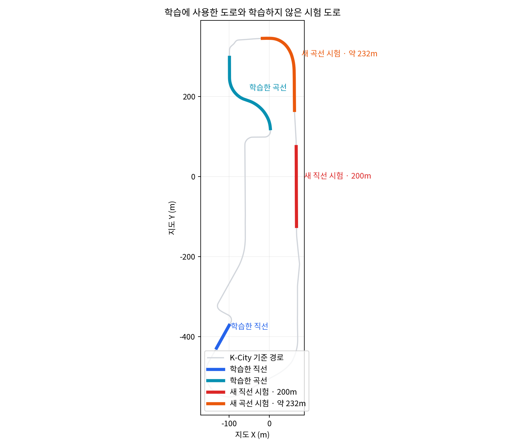

# PilotNet 주행 결과

MORAI K-City에서 가운데 카메라로만 학습한 모델과 좌·중·우 카메라로 학습한 모델을 비교했다. 차량을 제어할 때는 두 모델 모두 가운데 카메라 영상 한 장을 사용했다.

## 직선과 곡선 주행

학습에 사용하지 않은 200 m 직선과 약 232 m 곡선·연결도로에서 모델별로 한 번씩 출발했다. 아래 퍼센트는 각 주행이 기준 경로를 따라 진행한 거리의 비율이다.

| 시험 구간 | 가운데 카메라로 학습 | 3카메라로 학습 | 3카메라·곡선 샘플링 변경 |
|---|---:|---:|---:|
| 직선 · 200 m | 39.5%에서 중단 | 종점 도달 | 종점 도달 |
| 곡선·연결도로 · 약 232 m | 18.1%에서 중단 | 21.3%에서 중단 | 19.7%에서 중단 |

모두 경로 중앙에서 목표속도 19 km/h로 출발했다. **횡오차**는 차량이 기준 경로에서 옆으로 벗어난 거리다. 이 값이 7 m 이상이면 중단하고, 그 전에 경로의 마지막 1 m 구간에 들어가면 종점 도달로 기록했다.

추가 모델은 가운데 카메라의 보정 전 곡률을 기준으로 곡선 프레임을 골랐다. 추출할 때 곡선 프레임의 기대 비중은 68.2%에서 77.9%로 높아졌고, 곡선 시험은 두 설정 모두 경로 이탈로 끝났다. [샘플링 설정](curve_sampling.json)

지도에서 파란색 계열은 학습 도로, 빨간색과 주황색은 각각 시험용 직선과 곡선이다. 실행 인자에서는 직선을 `U1`, 곡선을 `U2`로 부른다.

## 기록 이미지에서의 곡률 예측

두 시험 도로에서 기록한 동일한 가운데 카메라 이미지 830장으로 곡률 예측값을 비교했다. 두 지표의 단위는 `1/m`이며 값이 작을수록 좋다.

| 학습 조건 | 곡률 RMSE | 곡률 MAE |
|---|---:|---:|
| 가운데 카메라 | 0.009216 | 0.005665 |
| 3카메라 | 0.007449 | 0.005595 |

## 주행 영상

직선·곡선 비교 영상에서 왼쪽은 가운데 카메라로만 학습한 모델, 오른쪽은 3카메라 모델이다. 먼저 종료한 영상은 마지막 장면에서 멈춘다.

시험용 직선 · 가운데 카메라 학습과 3카메라 학습

https://github.com/user-attachments/assets/096a658d-96da-4768-b581-1f41538266f7

시험용 곡선 · 가운데 카메라 학습과 3카메라 학습

https://github.com/user-attachments/assets/8a0d8432-1fd0-4297-a44d-84c379cf6832

곡선 샘플링을 바꾼 모델 · 곡선과 직선 주행

https://github.com/user-attachments/assets/0d5447ed-05c4-49b4-8b58-5e06ff542bfb

### 좌회전 경로가 있는 교차로

K-City 기준 경로 초반의 교차로를 실행 인자에서 `J`라고 부른다. 이 접근 도로는 PilotNet 학습에 사용한 직선과 일부 겹친다. 좌회전 경로를 기준으로 횡오차를 측정했다. 가운데 카메라 영상으로 조향을 예측한 차량은 직진 방향으로 나가다 중단됐다. [교차로 위치와 출구 그림](../../cil/results/README.md#시험-교차로) · [CIL과 나란히 보기](../../README.md#교차로-주행-데모)

PilotNet 교차로 주행

https://github.com/user-attachments/assets/248675d3-e24b-4e05-9902-c5ea20747ace

[주행별 수치](metrics/driving_trials.csv) · [곡선 샘플링 비교](metrics/curve_sampling_comparison.csv) · [이미지 예측 오차](metrics/open_loop.csv) · [재현 절차](../docs/reproduction.md)
