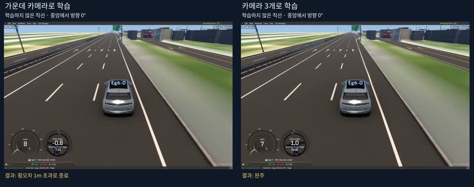

# 대표 주행 영상

기존 새 도로 비교 영상 3개에 교차로 사례 1개를 추가해, 공개 영상은 **4개**다.
모두 실제 MORAI 창 녹화이며, 01~03번은 학습하지 않은 도로의 시험이고 04번은 별도의 교차로 사례다.
모델의 실제 주행 입력은 가운데 카메라 한 장이다.

| 영상 | 학습 조건과 결과 |
|---|---|
| [01. 새 직선에서 카메라 1개와 3개 비교](videos/01_new_road_straight.mp4) | 200m 직선. 가운데 카메라 학습 모델은 중단, 카메라 3개 학습 모델은 완주했다. |
| [02. 새 곡선에서 카메라 1개와 3개 비교](videos/02_new_road_curve.mp4) | 곡선과 연결 직선 약 232m 구간. 두 모델 모두 초반에 횡오차 기준을 넘었다. |
| [03. 곡선 비중을 높인 카메라 3개 모델](videos/03_more_curve_training.mp4) | 같은 새 도로에서 정상 출발. 곡선 1회 중단, 직선 1회 완주했다. |
| [04. PilotNet의 교차로 주행 사례](videos/04_intersection.mp4) | 좌회전 평가 경로에서 직진 방향으로 진행하다 횡오차 기준을 넘어 중단됐다. |

04번 모델에는 좌회전·직진·우회전 명령 입력이 없다. 이 사례를 다음 CIL 구현으로 연결한다.
교차로 J(s40~108m)는 학습 수집 구간(s0~65m)과 일부 겹치므로, 01~03번의 새 도로 시험과 구분한다.

## 시험 구간

| 구분 | K-City 기준 경로의 진행거리 |
|---|---|
| 학습 데이터 수집 | 직선 0~65m, 곡선 640~866m |
| 새 직선 시험 (`U1`) | **1300~1500m** |
| 새 곡선과 연결 직선 시험 (`U2`) | **978.337~1210m** |

학습 구간과 시험 구간은 겹치지 않는다. 같은 K-City 맵·차량·맑은 낮 조건을 사용했다.
[학습 도로와 시험 도로 지도](images/course_map.png)

## 보는 방법

비교 영상의 왼쪽은 **가운데 카메라로 학습**, 오른쪽은 **카메라 3개로 학습**이다.
출발 조건과 결과를 영상 안에 표시했다. 서로 다른 실행의 녹화라 프레임 단위로 동기화하지 않았다.
원래 재생 속도를 유지하고, 한쪽 시험이 먼저 끝나면 **“시험 종료 · 마지막 화면 고정”**을 표시한다.
03번은 새 곡선 시험 다음에 새 직선 시험을 이어 붙였다.
GitHub에서 미리보기가 지원되지 않으면 MP4를 내려받아 재생한다.

## 평가 표

- [이미지 예측 평가](metrics/open_loop.csv): 새 도로의 동일한 가운데 카메라 이미지 830장, 두 모델 비교.
- [시험별 주행 결과](metrics/driving_trials.csv): 새 도로 2곳 × 두 모델 × 출발 조건 5가지, 총 20회.
- [곡선 비중 증가 실험](metrics/curve_sampling_comparison.csv): 기존 모델과 추가 학습 모델의 정상 출발 비교.
- [교차로 사례 수치](metrics/intersection_example.csv): 04번 영상에 해당하는 모델·평가 목표·횡오차.

출발 조건은 정상, 왼쪽/오른쪽 0.3m 치우침, 왼쪽/오른쪽 5° 헤딩 변화다.
각 조건은 1회씩 실행했다. 표에는 영상에서 생략한 조건의 성공·실패도 모두 남겼다.
추가 학습은 기존 train/validation만 사용하고 시험용 새 도로 이미지는 사용하지 않았다.
다만 baseline 결과를 본 뒤 진행한 탐색 실험이므로 새로운 미공개 시험으로 해석하지 않는다.
중단된 짧은 주행의 낮은 RMSE를 완주보다 우수하다고 해석하지 않는다.

학습한 도로의 내부 점검 영상과 학습 원본 영상은 로컬에 보관한다. 교차로 사례는 04번으로 추가했다.
전체 원본 영상과 프레임별 로그는 작업 PC의 `runs/`, `github_artifacts/`에 보존한다.
[영상 출처](video_sources.json)에는 각 편집 영상의 원본 경로와 SHA256을 기록했다.
[실행과 세부 조건](../docs/reproduction.md) · [곡선 추출 조건](curve_sampling.json)
